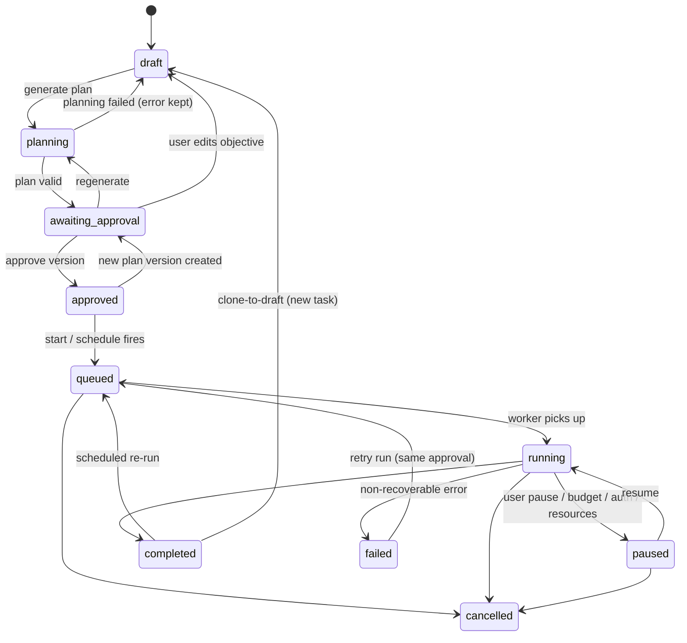
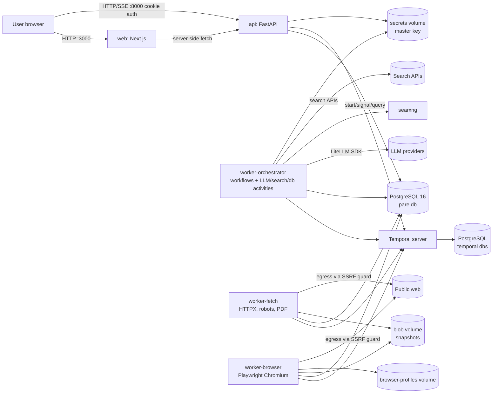
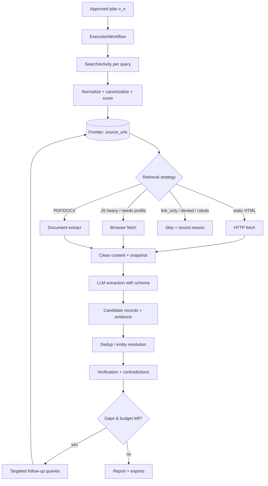
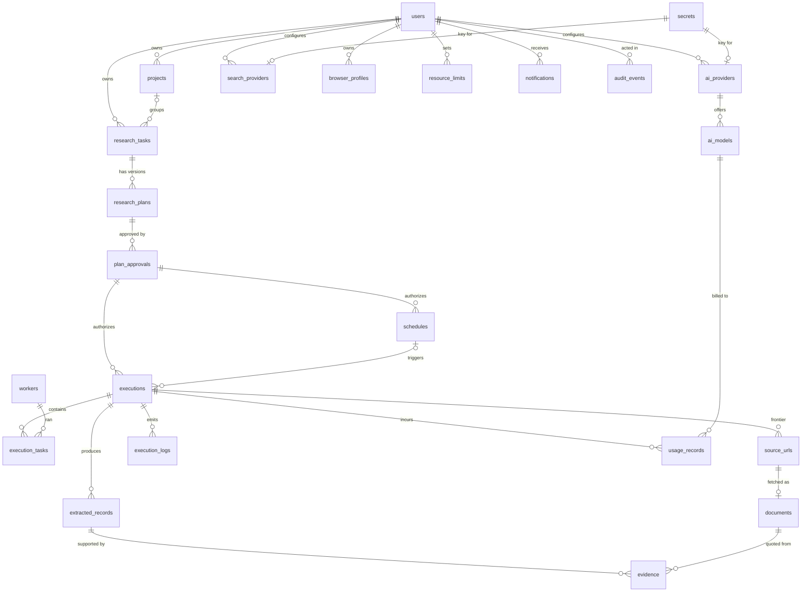
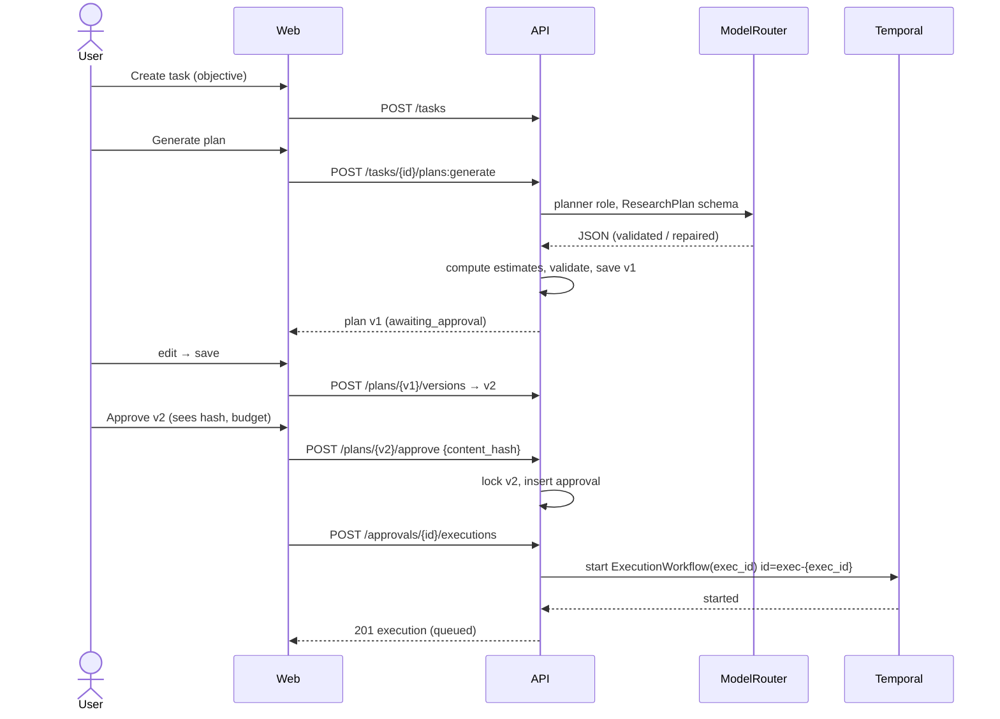
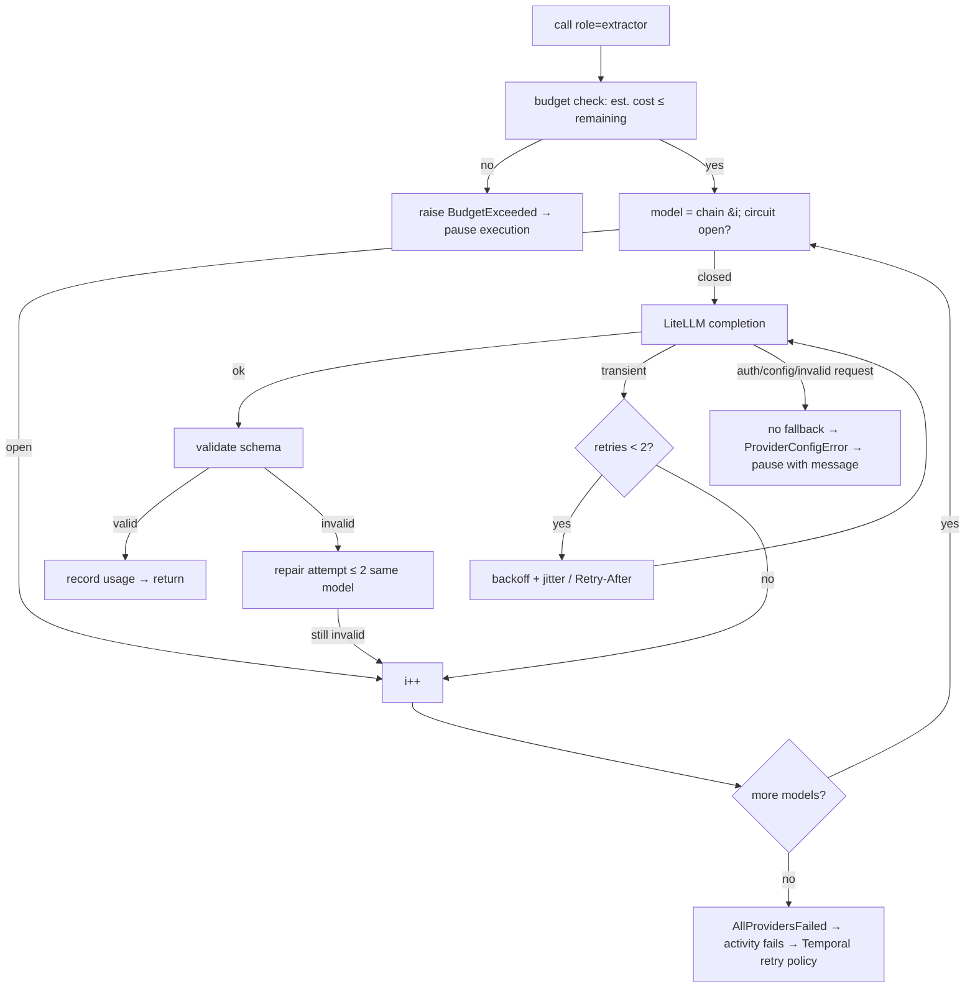
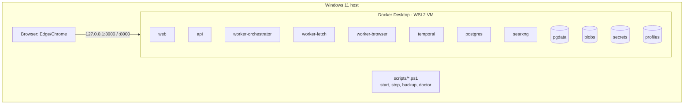

# Personal Autonomous Research Engine (PARE)
## Product Requirements Document

| | |
|---|---|
| Version | 1.0 (approved baseline for implementation) |
| Date | 2026-11-24 |
| Status | Baseline. Changes go through the change log at the end of this document. |
| Audience | Engineering team, AI coding agents, product, security reviewers |

### How to read this document

- **MUST / SHOULD / MAY** follow RFC 2119 meaning.
- Every requirement has an ID (`FR-xxx`, `NFR-xxx`, `SEC-xxx`, `AC-xx`). Code, tests and tickets reference these IDs.
- **[MVP]** marks work in the first usable release. **[Later]** marks work explicitly deferred. Unmarked items in a section inherit the section's marking.
- **[Assumption]** marks a decision made where the source requirements were silent. Each one is collected again in Part 29.
- Parts are numbered to match the deliverables list in the master prompt (1–29), followed by **MVP Scope** and the **Prioritized Engineering Backlog**.

---

## 0. Pre-PRD Analysis

This section was produced before the PRD itself, as the master prompt requires. It records contradictions in the requirements, how each is resolved, and the MVP/future split.

### 0.1 Contradictions and tensions in the requirements

| # | Tension | Resolution adopted in this PRD |
|---|---|---|
| C1 | "Windows-first **desktop** application" vs. a Next.js web dashboard running in Docker Desktop/WSL2. These are a local web app, not a native desktop app. | MVP is a **local web application** served from Docker containers and opened in the user's browser at `localhost`. A desktop shell (e.g. Tauri/Electron wrapper, system tray, auto-start) is **[Later]**. No Windows-native binaries in MVP. |
| C2 | Phase order puts **Research Execution (Phase 4)** before **Durable Orchestration / Temporal (Phase 5)**. Building execution first and retrofitting Temporal means rewriting the execution layer. | Temporal is introduced **at the start of Phase 4**. Execution steps are written as Temporal activities from day one. Phase 5 becomes "hardening": pause/resume/cancel semantics, recovery testing, checkpoint granularity. See Part 26. |
| C3 | Temporal adds a server, its own persistence and a UI — in tension with "avoid unnecessary infrastructure" and with low-RAM Windows machines. | Temporal is justified by the explicit requirements for durable, restart-surviving, pausable workflows (AC-17, AC-18). It runs as **one container** using the same PostgreSQL instance (separate databases). Its web UI is optional and off by default. Expected overhead is documented (Part 22); low-resource profile accounts for it. |
| C4 | Crawlee for Python, Playwright, and HTTPX all overlap. Crawlee brings its own request queue, storage and retry logic, which would compete with a Postgres URL frontier and Temporal retries (two sources of truth for "what has been fetched"). | MVP owns its fetch layer: **HTTPX** for HTTP, **Playwright** for browsers, a **Postgres-backed frontier**, and **Temporal** for retries. Crawlee is **[Later]** and may be adopted only as a stateless link-extraction/crawl helper inside an activity, with its storage disabled. |
| C5 | LiteLLM and Pydantic AI both provide model abstraction, retries and (in LiteLLM's Router) fallbacks. Two retry/fallback layers produce unpredictable behaviour and double billing on retry. | **Single routing authority**: PARE's own `ModelRouter` decides primary/fallback and retries, calling the **LiteLLM Python SDK** for one provider call at a time with LiteLLM's built-in retries and fallbacks disabled. Structured output is validated with **Pydantic** models. **Pydantic AI** is evaluated in Phase 3 and adopted only if it can call through `ModelRouter` without its own fallback. |
| C6 | "Do not show fabricated progress" vs. "estimate execution time and usage". | Estimates are always displayed as **ranges labelled "Estimate"**, computed from plan parameters and (later) historical runs. Live progress shows **counts of real events** (e.g. "37 of 120 planned fetches done, 4 failed"), never a percentage that is not a ratio of real counters. |
| C7 | "User can edit the plan" vs. "every execution references an immutable approved plan version". | Plans are **versioned**. Every edit creates a new version. Approval binds to a specific `plan_version_id` plus its **content hash**. Approved versions are read-only at the database level (trigger) and in the service layer. |
| C8 | Recurring runs execute automatically vs. "material changes require renewed approval". The prompt does not define "material". | "Material change" is defined precisely in FR-SCH-010: any change to objective, source allow/deny lists, domains, browser profiles used, extraction schema, max budget increase, max pages increase > 0, schedule frequency increase, or permissions. Non-material: schedule time-of-day shift, decreasing limits, notification settings. |
| C9 | "Continuous discovery within defined limits" vs. "maximum execution time" and budgets. Continuous work cannot be unbounded. | Continuous discovery is modelled as a **recurring schedule with a carried-over frontier** and a hard daily budget, not as an endless workflow. Each run is bounded. |
| C10 | "Multiple isolated persistent browser profiles" vs. "never rotate profiles to evade restrictions". | A profile is **bound to domains** by the user. The system chooses a profile only by domain binding. On a block, CAPTCHA, login wall or 429, the system **stops using that domain for the run**, records the reason, and may ask the user to re-authenticate manually. It never switches to a different profile for the same domain within a run to retry a blocked request. |
| C11 | Example objective collects **founders** and **LinkedIn pages**. LinkedIn's User Agreement prohibits automated scraping, and founder data is personal data (India DPDP Act 2023, GDPR for EU persons). | PARE **records LinkedIn URLs when they appear on the company's own site or in search results**; it does not fetch or crawl LinkedIn pages in MVP. Domains with known automated-access prohibitions can be put on a default deny/"link-only" list (FR-SRC-030). Personal data is limited to professional, publicly stated facts (name, role) with source attribution, and is deletable (FR-PRIV). |
| C12 | "Authentication" and "multi-user/tenant isolation" vs. MVP being a single-user local app. | MVP has **real local accounts** (email + password) and every row carries an owner. One install may have several local users (rare). Organizations/teams are **[Later]** but the schema reserves `organization_id` from Phase 8 via migration, not now (avoid unused columns). |
| C13 | API keys must be "encrypted at rest" locally, but there is no KMS on a local Windows install, and Windows DPAPI is not reachable from Linux containers. | Envelope encryption with a **local master key file** generated on first start, stored in a Docker volume separate from the database volume, readable only by the API/worker containers. The risk (anyone with access to both volumes can decrypt) is stated honestly in the threat model. OS keychain / cloud KMS is **[Later]**. |
| C14 | "Windows 10 compatibility where supported dependencies permit". Docker Desktop's documented minimums are Windows 10 22H2 and Windows 11 (verify at install time — they change); Windows 10 reached end of support on 14 Oct 2025 (paid ESU only). | Windows 11 (23H2+) is the supported target. Windows 10 22H2 is "best effort, not tested in CI". The installer checks the OS build and warns. |
| C15 | Excel export required "where practical" while the stack says "avoid unnecessary dependencies". | CSV and JSON are MVP. XLSX (via `openpyxl`) and PDF are delivered in Phase 7. |
| C16 | The dashboard requires an "Active executions" count in Phase 1, before execution exists. | The count is computed from real task status (`queued` + `running`), which will be 0 in Phase 1. No placeholder numbers. |

### 0.2 MVP vs. future split (summary)

Detailed in **MVP Scope** at the end. In short:

- **MVP (Phases 1–7)**: single machine, Windows via Docker Desktop; local accounts; projects and tasks; 3+ LLM providers with fallback; structured plans with versioning and approval; search (SearXNG + 1 API provider), HTTP fetch, Playwright for JS pages, PDF extraction; Postgres frontier; Temporal workflows with pause/resume/cancel and restart recovery; scheduling with budgets; deduplication, cross-source verification, contradiction flags; evidence viewer; CSV/JSON/XLSX/PDF export.
- **Later (Phase 8+)**: multi-browser-profile manager beyond one profile per domain, adaptive resource manager with automatic scaling, cloud/remote workers, organizations/teams/RBAC, desktop shell, macOS/Linux packaged installers, S3/MinIO, Crawlee, OS keychain, SSO.

### 0.3 Global assumptions (detail in Part 29)

- **[Assumption A1]** Primary user runs PARE on their own machine; the app listens only on `127.0.0.1` by default.
- **[Assumption A2]** The user brings their own LLM API keys and pays providers directly. PARE tracks estimated cost, not billing.
- **[Assumption A3]** English-language research is the MVP focus; content in other languages is stored and passed to the LLM but not specifically optimised.
- **[Assumption A4]** A typical research run is 50–2,000 fetched pages and finishes in under 4 hours.

---

## 1. Executive Summary

PARE turns a research question written in plain language into a **reviewed plan**, then **executes that plan unattended**: it searches, fetches pages and documents, extracts structured fields, cross-checks them across sources, and delivers a table and report where **every value links to the evidence it came from**.

It is built for people who currently do this work by hand with dozens of browser tabs and a spreadsheet: analysts, founders, researchers, developers. Its differentiators are:

1. **Plan-then-execute with explicit approval.** Nothing runs until the user approves a specific, versioned plan with scope and budget limits.
2. **Provenance on every field.** Values without evidence are flagged, not hidden.
3. **Durable, resumable runs.** Long runs survive restarts, can be paused, and recover from worker crashes.
4. **Bring-your-own models.** Multiple LLM providers with ordered fallback; no lock-in.
5. **Local-first.** Data, keys and browser profiles stay on the user's machine in MVP.
6. **Responsible by construction.** Respects robots.txt, rate limits and access controls; never bypasses CAPTCHAs, paywalls or logins it is not authorised for.

The first release is a local web app on Windows (Docker Desktop + WSL2). The architecture is a modular monolith with separate worker processes, designed to move to cloud workers and multi-user deployment later without a rewrite.

---

## 2. Product Vision and Goals

### 2.1 Vision

> A research assistant you can hand a question to before lunch and come back to a sourced, verified dataset — and trust it because you can see exactly where each fact came from.

### 2.2 Goals (measurable, for MVP)

| ID | Goal | Metric | Target |
|---|---|---|---|
| G1 | Reduce manual research time | Time from objective to exported dataset, vs. user's manual baseline (user study) | ≥ 70 % reduction for list-building tasks of 20–100 entities |
| G2 | Trustworthy output | Share of populated fields with ≥ 1 linked evidence item | 100 % (hard requirement) |
| G3 | Verified output | Share of "key fields" (plan-defined) confirmed by ≥ 2 independent domains | ≥ 60 % on benchmark tasks |
| G4 | Accuracy | Field-level precision on a hand-labelled benchmark set of 5 tasks | ≥ 90 % for fields marked "verified"; ≥ 75 % overall |
| G5 | Reliability | Runs that complete (not counting user cancels and budget stops) | ≥ 95 % |
| G6 | Recoverability | Runs that resume correctly after a forced `docker compose restart` mid-run | 100 % in test suite |
| G7 | Cost control | Runs exceeding approved LLM budget | 0 (hard stop) |
| G8 | Approachability | Nontechnical tester completes first research run without help | ≥ 4 of 5 testers |

### 2.3 Non-goals

- PARE is **not** a general-purpose scraper that ignores site rules, and not a tool to collect data behind logins the user does not hold.
- Not a CAPTCHA solver, proxy rotator, fingerprint spoofer or account farm. These will not be built (see SEC-030).
- Not a real-time monitoring/alerting product in MVP (recurring runs yes; sub-minute monitoring no).
- Not a social-media data harvesting tool for profiling private individuals.
- Not a replacement for licensed data providers (Crunchbase, PitchBook, etc.). Users may integrate APIs they are licensed for via adapters **[Later]**.

---

## 3. Problem Statement

Structured desk research — "find the top N companies/papers/products matching X and collect fields Y for each, with sources" — is repetitive and error-prone:

- **Fragmented sources.** Facts are spread across official sites, directories, news, filings and PDFs.
- **No provenance.** Copy-pasted spreadsheets lose where each value came from; re-verification costs as much as the original work.
- **Conflicting data.** Funding amounts, headcounts and founding dates differ between sources and nobody records the disagreement.
- **Staleness.** Repeating the research next month means redoing it.
- **Existing AI tools** (chat-based "deep research") produce prose with a handful of citations, not complete, field-level structured datasets; they do not let the user approve scope or budgets up front, do not persist evidence per field, and do not resume long runs.
- **Existing scrapers** require code per site and do not reason about what to look for.

PARE closes the gap between "AI that writes a summary" and "scraper that needs code": a planner that reasons, an executor that is disciplined and durable, and an output layer that is auditable.

---

## 4. Target Users and Personas

| Persona | Description | Primary needs | MVP priority |
|---|---|---|---|
| **P1 Priya — Independent analyst / consultant** | Builds market maps and competitor lists for clients. Not a programmer. Windows laptop, 16 GB RAM. | Lists of companies with verified fields; exports to Excel; client-ready report; confidence she can defend each number. | **Primary** |
| **P2 Dev — Developer / technical founder** | Researches tools, vendors, open-source projects; comfortable with Docker and APIs. | Bring own models; JSON export; API access; recurring tracking of competitors. | **Primary** |
| **P3 Rhea — Academic / policy researcher** | Collects reports, PDFs and statistics across government and NGO sites. | PDF extraction, citations, document archive, reproducibility. | Secondary |
| **P4 Team lead (future)** | Runs a small research team. | Shared projects, roles, audit, cloud workers. | **[Later]** |
| **P5 Admin (future)** | Manages an org deployment. | SSO, policies, usage caps per user. | **[Later]** |

Anti-persona: someone wanting to bulk-harvest personal profiles, evade blocks or scrape logged-in social networks. Product policy and technical controls (Part 21) work against this use.

---

## 5. User Journeys

### J1 — First-run onboarding (P1)
1. User installs Docker Desktop (guided by README / installer check script), runs `scripts\start.ps1`.
2. Browser opens `http://localhost:3000`. No account exists → **Create local account** screen.
3. Onboarding checklist: (a) add an AI provider and test it, (b) confirm search provider (SearXNG is bundled and pre-configured), (c) review default limits detected from hardware.
4. Dashboard shows an empty state with "Create your first research task".

### J2 — One-off research (P1, core journey)
1. **Create task**: title, objective (free text), optional project, optional hints (must-include sources, excluded domains, desired fields, target count).
2. **Plan generation** (status `planning`): live log of the planner's real steps. Typically < 60 s.
3. **Review plan** (status `awaiting_approval`): objective restated, subtasks, queries, source strategy, extraction schema (fields, types, required/optional, key fields for verification), target count, limits, estimates (ranges), risks/notes (e.g. "LinkedIn will be link-only").
4. User **edits** (creates plan v2) — e.g. removes a field, adds a domain to the deny list, lowers max pages.
5. User **approves** v2 → modal summarises budget and scope; explicit confirm. Status `approved`, then `queued` → `running`.
6. **Monitor**: real counters (queries run, URLs discovered/fetched/failed/skipped by robots, records extracted, LLM tokens and estimated cost vs. budget), event log, per-domain status. Pause / Resume / Cancel available.
7. **Completed**: Result explorer table; cells coloured by confidence; click a cell → evidence drawer (source URL, quote/snippet, fetch time, archived snapshot, extraction model). Conflicts panel. Missing-data panel.
8. **Export** CSV/JSON/XLSX/PDF report.

### J3 — Recurring tracking (P2)
1. From a completed task: "Run this on a schedule" → choose weekly, timezone, end date, per-run and daily limits.
2. If the schedule does not change scope, approval of the existing plan version applies (FR-SCH-010). Otherwise renewed approval required.
3. Each run produces a new execution; **Run comparison** shows added/removed entities and changed field values with evidence for both.

### J4 — Failure and recovery (any persona)
1. During a run, the machine sleeps / Docker restarts.
2. On restart, Temporal resumes the workflow; the monitor shows "Resumed after interruption at 14:02" with real counts continuing from the checkpoint. No duplicate fetches of completed URLs (idempotency keys).
3. If an LLM provider returns 5xx repeatedly, the router falls back; the monitor shows "Switched to fallback model X for extraction (reason: provider unavailable)".
4. If credentials are invalid, the run **pauses** with an actionable error ("Anthropic key rejected (401). Update key in AI Providers, then Resume.") — no blind fallback (FR-LLM-022).

### J5 — Authenticated source (P3) **[MVP, single profile per domain]**
1. User has legitimate access to a portal (e.g. a library database). Creates a browser profile bound to that domain; a headed browser window (via noVNC in browser, see Part 19) opens; user logs in manually.
2. Plan lists that profile as required; approval covers its use.
3. If the session expires mid-run, tasks for that domain pause with "Re-authentication required"; other domains continue.

### J6 — Budget stop
1. LLM spend estimate reaches 100 % of the approved budget → workflow stops scheduling new LLM work, finishes in-flight calls, status `paused` with reason `budget_exhausted`. User can raise budget (= material change → new approval) or finish with partial results.

---

## 6. Functional Requirements

Priority: **P0** = MVP blocker, **P1** = MVP, **P2** = Later.

### 6.1 Accounts and projects
| ID | Requirement | Pri | Phase |
|---|---|---|---|
| FR-AUTH-001 | Users can register a local account (email, password ≥ 10 chars, display name). | P0 | 1 |
| FR-AUTH-002 | Users can log in and log out. Sessions use an HttpOnly, SameSite=Lax cookie carrying a signed short-lived JWT (default 12 h). | P0 | 1 |
| FR-AUTH-003 | `GET /me` returns the current user. | P0 | 1 |
| FR-AUTH-004 | Registration can be disabled after the first user (`ALLOW_REGISTRATION=false`) for shared machines. | P1 | 1 |
| FR-AUTH-005 | Password change and session revocation (token version bump). | P1 | 2 |
| FR-PRJ-001 | CRUD projects (name unique per owner, description). | P0 | 1 |
| FR-PRJ-002 | Tasks may belong to zero or one project; deleting a project with tasks is blocked unless tasks are moved or `?cascade=detach` is passed (tasks become unassigned). | P0 | 1 |
| FR-PRJ-003 | All reads/writes are scoped to the owner; another user's IDs return 404 (not 403) to avoid enumeration. | P0 | 1 |

### 6.2 Research tasks
| ID | Requirement | Pri | Phase |
|---|---|---|---|
| FR-TSK-001 | Create a task with title (1–200), objective (10–5,000 chars), optional description, optional project. New tasks are `draft`. | P0 | 1 |
| FR-TSK-002 | List tasks with pagination (`page`, `page_size` ≤ 100), text search on title/objective, filter by status and project, sort by `updated_at` desc default. | P0 | 1 |
| FR-TSK-003 | Edit title/objective/description/project **only in `draft`**. Other states return `409 TASK_NOT_EDITABLE`. | P0 | 1 |
| FR-TSK-004 | Delete a task in `draft`, `awaiting_approval`, `approved`, `completed`, `failed`, `cancelled`. Deleting `planning`/`queued`/`running`/`paused` returns 409 `TASK_NOT_DELETABLE` (cancel first). | P0 | 1 |
| FR-TSK-005 | Status values: `draft, planning, awaiting_approval, approved, queued, running, paused, completed, failed, cancelled`. Transitions are enforced by a single state machine (Part 8.1); clients cannot set status directly. | P0 | 1 |
| FR-TSK-006 | Task detail shows plan versions, approvals, executions and schedule. | P0 | 3 |
| FR-TSK-007 | Duplicate a task (copies objective and latest plan as a new draft). | P2 | 6 |

### 6.3 AI provider management
| ID | Requirement | Pri | Phase |
|---|---|---|---|
| FR-LLM-001 | Add provider: type (openai, gemini, anthropic, xai, deepseek, mistral, openai_compatible), display name, API key, optional base URL (required for openai_compatible). | P0 | 2 |
| FR-LLM-002 | Add one or more models per provider (model identifier string, context window, input/output price per 1M tokens — user-editable, prefilled where LiteLLM's model cost map has values). | P0 | 2 |
| FR-LLM-003 | Test connection: performs a minimal completion (max 5 output tokens) and reports latency, success, or classified error. | P0 | 2 |
| FR-LLM-004 | Configure routing per **role** (`planner`, `extractor`, `verifier`, `summarizer`): one primary model + ordered fallbacks. A global default applies when a role is unset. | P0 | 2 |
| FR-LLM-005 | Enable/disable provider or model without deleting it. | P0 | 2 |
| FR-LLM-006 | Provider health: rolling success rate, p50/p95 latency, last error, circuit-breaker state. | P1 | 2 |
| FR-LLM-007 | Usage: tokens and estimated cost per provider/model/day/execution. | P1 | 2 |
| FR-LLM-008 | Key replace and remove. The key is write-only from the UI; only the last 4 characters are ever returned. | P0 | 2 |
| FR-LLM-020 | Fallback: retry transient errors on the same model (max 2, exponential backoff with jitter, honour `Retry-After`), then move to next fallback. | P0 | 2 |
| FR-LLM-021 | Transient = timeout, connection error, 429, 500, 502, 503, 504, 529, provider "overloaded". | P0 | 2 |
| FR-LLM-022 | Non-fallback errors = 400 invalid request, 401/403 auth, 404 model not found, content-policy refusal, context-length exceeded (handled by chunking, not fallback), our own schema-validation errors after repair attempts. Auth errors pause the execution with an actionable message. | P0 | 2 |
| FR-LLM-023 | Every LLM call records provider, model, role, attempt number, tokens in/out, latency, estimated cost, outcome, and the execution/task it served. | P0 | 2 |
| FR-LLM-024 | At least **three** provider types are tested end-to-end at launch (OpenAI, Anthropic, Gemini). Others are supported through the same adapter and tested with recorded fixtures. | P0 | 2 |

### 6.4 Research planning
| ID | Requirement | Pri | Phase |
|---|---|---|---|
| FR-PLN-001 | Generate a plan from task objective + hints using the `planner` role. Output must validate against `ResearchPlan` schema (Part 8.3). Up to 2 automatic repair attempts on invalid output (send validation errors back). | P0 | 3 |
| FR-PLN-002 | Plan contains: restated objective, scope (in/out), entity type, target count, extraction schema, subtasks, search queries, source strategy (preferred source types, allow/deny domains), retrieval strategy hints, verification strategy (key fields, min independent sources), dedup strategy (entity key fields), limits, estimates, risks. | P0 | 3 |
| FR-PLN-003 | Estimates computed **deterministically by code** from plan parameters (not invented by the LLM): fetch count range, LLM tokens range, cost range, duration range given current concurrency. | P0 | 3 |
| FR-PLN-004 | Users can edit any plan field in a structured editor (not raw JSON for nontechnical users; JSON view available). Each save creates an immutable new version with `parent_version_id`. | P0 | 3 |
| FR-PLN-005 | Plan diff between versions. | P1 | 3 |
| FR-PLN-006 | Users can regenerate the plan with feedback ("add GitHub stars as a field"). | P1 | 3 |
| FR-PLN-007 | Validation beyond schema: target count ≤ max entities limit; max pages ≥ estimated minimum; at least one query; deny list cannot contain all allowed domains; fields have unique names; key fields exist in schema. | P0 | 3 |

### 6.5 Approval
| ID | Requirement | Pri | Phase |
|---|---|---|---|
| FR-APR-001 | Approve a specific plan version. Stores approver, timestamp, plan content hash (SHA-256 of canonical JSON), and the resource policy snapshot (limits). | P0 | 3 |
| FR-APR-002 | **Execution cannot start without an approval record whose hash matches the plan version** (enforced in service layer *and* by a DB foreign key + check in the workflow start activity). | P0 | 3 |
| FR-APR-003 | Approval can be revoked; revoking cancels queued runs and disables schedules using it. | P1 | 6 |
| FR-APR-004 | Approval modal shows budget, max pages, domains, browser profiles that will be used, schedule (if any). | P0 | 3 |

### 6.6 Execution
| ID | Requirement | Pri | Phase |
|---|---|---|---|
| FR-EXE-001 | Start execution of an approved plan version (immediately or by schedule). Creates `executions` row and Temporal workflow with ID `exec-{execution_id}`. | P0 | 4 |
| FR-EXE-002 | Search stage: run plan queries against enabled search providers within limits; normalise results; canonicalise URLs; dedupe; score relevance; push to frontier. | P0 | 4 |
| FR-EXE-003 | Fetch stage: choose retrieval method per URL (Part 18.4): HTTP → browser escalation only when needed; documents to extraction worker. | P0 | 4 |
| FR-EXE-004 | Respect robots.txt (cached 24 h per host), per-domain rate limits (default 1 req / 2 s / domain, configurable down to 1 req / 10 s, up to 2 req/s only for allow-listed domains), max pages, max depth. | P0 | 4 |
| FR-EXE-005 | Store raw content (compressed) for every successful fetch with content hash; reuse within the same execution; reuse across executions if within freshness window (default 24 h) and user setting allows. | P0 | 4 |
| FR-EXE-006 | Extraction: content → clean text/markdown → LLM `extractor` with schema → candidate records with per-field evidence (quote ≤ 500 chars, char offsets, URL, snapshot ID). Values without a supporting quote are rejected or marked `unsupported`. | P0 | 4 |
| FR-EXE-007 | Pause: stop dispatching new activities; in-flight ones finish or time out; state persisted. Resume continues from frontier. | P0 | 5 |
| FR-EXE-008 | Cancel: stop dispatch, cancel in-flight activities (cooperative, heartbeat-checked), mark `cancelled`, keep partial results. | P0 | 5 |
| FR-EXE-009 | Emergency stop: one control in the top bar that cancels **all** running executions and pauses all schedules. | P0 | 6 |
| FR-EXE-010 | Live updates via SSE (Part 15.7). | P0 | 4 |
| FR-EXE-011 | Every execution logs structured events with `execution_id` correlation. | P0 | 4 |
| FR-EXE-012 | Execution terminates as `completed` when target count reached with key fields filled and verification done, or frontier exhausted, or limits reached (with `completion_reason`). | P0 | 4 |

### 6.7 Intelligence and verification
| ID | Requirement | Pri | Phase |
|---|---|---|---|
| FR-INT-001 | Entity deduplication by normalised key fields (e.g. canonical domain for companies) then fuzzy name match (token-set ratio ≥ 0.92) with LLM tie-break for ambiguous pairs. Merges retain all evidence. | P0 | 7 |
| FR-INT-002 | Verification: a key field is `verified` when ≥ N (default 2) **independent** evidence items agree; independent = different registrable domains (eTLD+1) and not the same syndicated content hash. | P0 | 7 |
| FR-INT-003 | Contradiction: same field, ≥ 2 evidence items with non-equivalent values (type-aware comparison: numbers within tolerance, dates by precision, strings normalised). Shown with both sources. | P0 | 7 |
| FR-INT-004 | Missing data: required fields without evidence are listed per entity; optional targeted follow-up searches ("{entity} {field}") within remaining budget. | P1 | 7 |
| FR-INT-005 | Confidence score per field ∈ [0,1] from a documented formula (Part 18.8), shown as High / Medium / Low / Unsupported. | P0 | 7 |
| FR-INT-006 | Run comparison for recurring executions: entity added/removed, field changed (old/new + evidence). | P1 | 7 |
| FR-INT-007 | Final report: summary (LLM `summarizer`, citing evidence IDs only), methodology (auto-generated from plan + real stats), table, conflicts, gaps, source list. | P0 | 7 |

### 6.8 Export
| ID | Requirement | Pri | Phase |
|---|---|---|---|
| FR-EXP-001 | CSV (one row per entity; `field`, `field__confidence`, `field__sources` columns). UTF-8 with BOM for Excel compatibility; formula-injection protection (prefix `'` to cells starting with `= + - @ \t \r`). | P0 | 7 |
| FR-EXP-002 | JSON (full structure incl. evidence). | P0 | 7 |
| FR-EXP-003 | XLSX (sheets: Results, Evidence, Conflicts, Sources, Methodology). | P1 | 7 |
| FR-EXP-004 | PDF report (HTML template → PDF via Playwright `page.pdf()`, reusing the browser worker image). | P1 | 7 |

### 6.9 Scheduling
| ID | Requirement | Pri | Phase |
|---|---|---|---|
| FR-SCH-001 | Schedule types: once at datetime, every N minutes (N ≥ 15), hourly, daily, weekly, monthly, cron (5-field), continuous discovery (bounded recurring). | P0 | 6 |
| FR-SCH-002 | IANA timezone per schedule; DST handled by Temporal Schedules' calendar specs. | P0 | 6 |
| FR-SCH-003 | Start/end dates; pause/resume schedule; skip overlapping runs (overlap policy = `SKIP`, configurable to `BUFFER_ONE`). | P0 | 6 |
| FR-SCH-004 | Per-run limits (pages, duration, workers, LLM budget) and per-day limits (LLM budget, pages) across all runs of the schedule. | P0 | 6 |
| FR-SCH-010 | **Material change** (requires new approval): objective; scope; extraction schema; allow/deny domains; browser profiles; any limit increase; frequency increase. Non-material: decreasing limits, time-of-day/timezone change with same or lower frequency, notifications, end-date earlier. | P0 | 6 |
| FR-SCH-011 | Upcoming runs preview (next 5 fire times). | P1 | 6 |

### 6.10 Browser profiles
| ID | Requirement | Pri | Phase |
|---|---|---|---|
| FR-BRW-001 | Create named profile bound to one or more domains (eTLD+1). Profile = persistent Playwright user-data dir in an isolated volume path. | P1 | 4 |
| FR-BRW-002 | Manual login session: open headed browser in a noVNC panel; user signs in; close saves state. | P1 | 4 |
| FR-BRW-003 | Session expiry detection (login-wall heuristics + plan-provided "logged-in selector") → domain tasks paused, user notified. | P1 | 4 |
| FR-BRW-004 | Delete profile securely (directory removal + record). | P1 | 4 |
| FR-BRW-005 | Multiple concurrent profiles with separate browser contexts. | P2 | 8 |

### 6.11 Resource management
| ID | Requirement | Pri | Phase |
|---|---|---|---|
| FR-RES-001 | Detect RAM, CPU cores, free disk, architecture, Docker memory limit (cgroup), at worker start and every 30 s. | P0 | 4 |
| FR-RES-002 | Choose default profile (Low/Medium/High, §9.3) on first run; user may override within safe maxima. | P0 | 4 |
| FR-RES-003 | Separate concurrency limits for HTTP fetch, browser, document extraction and LLM calls. | P0 | 4 |
| FR-RES-004 | Backpressure: if container memory > 85 % of limit or free disk < 2 GB, stop dispatching new browser/extraction work; resume at < 70 %. | P0 | 5 |
| FR-RES-005 | Storage limit per execution and global; reaching global limit pauses all executions. | P1 | 6 |
| FR-RES-006 | Adaptive concurrency (AIMD on per-domain latency/error rate and host resources). | P2 | 8 |

### 6.12 Notifications
| ID | Requirement | Pri | Phase |
|---|---|---|---|
| FR-NTF-001 | In-app notifications: approval needed, run completed/failed/paused (with reason), re-auth needed, budget reached. | P1 | 6 |
| FR-NTF-002 | Email/webhook notifications. | P2 | 8 |

### 6.13 Privacy
| ID | Requirement | Pri | Phase |
|---|---|---|---|
| FR-PRIV-001 | Personal data fields (marked `personal: true` in schema, e.g. founder name) are only collected when the plan lists them and the user approves. | P0 | 3 |
| FR-PRIV-002 | Delete all data for an execution or task (records, evidence, snapshots) on request. | P0 | 7 |
| FR-PRIV-003 | Default data retention for raw snapshots: 90 days (configurable); extracted records + evidence quotes retained until deleted. | P1 | 7 |

---

## 7. Non-Functional Requirements

| ID | Category | Requirement |
|---|---|---|
| NFR-001 | Performance | Dashboard and list API p95 < 300 ms with 10k tasks / 1M evidence rows on a Medium machine. |
| NFR-002 | Performance | SSE event latency from activity event to UI < 2 s p95. |
| NFR-003 | Throughput | Medium profile sustains ≥ 2 HTTP fetches/s aggregate (across domains) and 2 concurrent browser pages without exceeding memory backpressure. |
| NFR-004 | Startup | `docker compose up` to healthy API in < 90 s on a Medium machine with images cached. |
| NFR-005 | Resource ceiling | Default total container memory limits ≤ 50 % of host RAM; never > 75 % even when user raises limits. |
| NFR-006 | Durability | No committed result is lost on container restart; WAL-enabled Postgres in named volume. |
| NFR-007 | Recovery | Workflows resume within 60 s of worker restart. |
| NFR-008 | Idempotency | Re-running any activity with the same idempotency key creates no duplicate rows (unique constraints). |
| NFR-009 | Observability | Structured JSON logs with `request_id`, `execution_id`, `workflow_id`, `activity`, `user_id`; no secrets. |
| NFR-010 | Security | OWASP ASVS Level 2 for the API surface (local deployment). |
| NFR-011 | Accessibility | WCAG 2.2 AA for core flows (keyboard, contrast, labels, focus). |
| NFR-012 | Usability | Nontechnical user completes J2 without reading docs (G8). |
| NFR-013 | Maintainability | Backend coverage ≥ 80 % lines in `services/` and `domain/`; mypy/pyright strict on new modules; ESLint + `tsc --noEmit` clean. |
| NFR-014 | Portability | All services run in Linux containers; no Windows-only code paths except PowerShell helper scripts. |
| NFR-015 | Compatibility | Latest Chrome, Edge, Firefox. |
| NFR-016 | Internationalisation | UI strings centralised; dates rendered in user's timezone; UTF-8 throughout. |
| NFR-017 | Upgrades | Alembic migrations forward-only in production; each release tested upgrading from previous release's DB snapshot. |
| NFR-018 | Licensing | All dependencies OSI-licensed and compatible with commercial distribution; Temporal (MIT), SearXNG (AGPL-3.0 — run as separate unmodified container; no linking), Playwright (Apache-2.0). |

---

## 8. Detailed Feature Specifications

### 8.1 Research task state machine



Rules:
- The **task status mirrors the latest execution** while one is active; each execution has its own status (`queued, running, paused, completed, failed, cancelled`).
- Transitions live in one module (`domain/task_state.py`) with a table of allowed `(from, to, trigger)`; every transition writes an `audit_events` row.
- Phase 1 implements only `draft` creation/editing/deletion; the state machine module and enum are complete from Phase 1 so later phases do not migrate the enum.

### 8.2 Create Research Task
- Fields: Title (required), Objective (required, multiline, character counter), Description/notes (optional), Project (select, optional), **Hints** (Phase 3): target count, desired fields (chips), include domains, exclude domains, recency ("published after").
- Validation errors are inline; submit disabled while invalid; server errors shown in a toast + inline.
- After create: navigate to task detail with primary CTA "Generate plan" (Phase 3; in Phase 1 the CTA is shown disabled with label "Planning — coming in a later release").

### 8.3 Research Plan schema (canonical)

The plan is JSON validated by Pydantic (`ResearchPlanV1`), stored in `research_plans.content` (JSONB) with `schema_version`.

```jsonc
{
  "schema_version": 1,
  "objective": "Identify 50 AI startups headquartered in India ...",
  "scope": {
    "in_scope": ["Companies founded 2015 or later", "HQ in India"],
    "out_of_scope": ["Subsidiaries of non-Indian multinationals"],
    "recency": {"published_after": "2023-01-01"}
  },
  "entity": {"type": "organization", "label": "AI startup"},
  "target_count": 50,
  "extraction_schema": {
    "fields": [
      {"name": "company_name", "type": "string", "required": true, "key": true, "personal": false,
       "description": "Legal or commonly used company name"},
      {"name": "website", "type": "url", "required": true, "key": true, "normalize": "registrable_domain"},
      {"name": "founders", "type": "list[person_name]", "required": false, "personal": true},
      {"name": "total_funding_usd", "type": "money", "required": false, "verify": true,
       "tolerance": {"relative": 0.1}},
      {"name": "headquarters_city", "type": "string", "required": true, "verify": true},
      {"name": "linkedin_url", "type": "url", "required": false, "retrieval": "link_only"}
    ],
    "dedup_keys": ["website", "company_name"]
  },
  "subtasks": [
    {"id": "s1", "kind": "discover", "description": "Find candidate startups from directories and news",
     "queries": ["top AI startups India 2026", "Indian generative AI startups funding"],
     "max_results_per_query": 20},
    {"id": "s2", "kind": "enrich", "description": "Visit official websites for description/products/HQ",
     "depends_on": ["s1"]},
    {"id": "s3", "kind": "enrich", "description": "Public funding information", "depends_on": ["s1"],
     "query_templates": ["{company_name} funding round"]},
    {"id": "s4", "kind": "verify", "fields": ["total_funding_usd", "headquarters_city"], "depends_on": ["s2","s3"]}
  ],
  "sources": {
    "preferred_types": ["official_site", "news", "directory", "filing"],
    "allow_domains": [],
    "deny_domains": [],
    "link_only_domains": ["linkedin.com"],
    "browser_profiles": []
  },
  "verification": {"min_independent_sources": 2, "key_fields": ["total_funding_usd","headquarters_city"]},
  "limits": {
    "max_pages": 800, "max_depth": 2, "max_duration_minutes": 180,
    "max_llm_cost_usd": 5.00, "max_browser_workers": 2, "max_http_workers": 8,
    "per_domain_rps": 0.5, "max_retries_per_url": 2, "max_storage_mb": 1024
  },
  "estimates": { /* filled by code, never by LLM */ },
  "risks": ["Funding data often inconsistent across news sources"]
}
```

Allowed field types (MVP): `string, text, integer, number, money, percent, date, url, email, list[string], list[person_name], boolean, enum`. `retrieval` ∈ `auto | link_only | http_only | browser_only`.

### 8.4 Plan review and approval screen
- Left: structured plan sections as collapsible cards; editable inline. Right rail: **Estimates** (ranges), **Limits**, **Approval** box.
- Warnings banner for validation issues and policy notes (e.g., "linkedin.com set to link-only by default policy").
- "Approve and run now" and "Approve and schedule…" buttons → confirmation modal listing: version number, hash prefix, budget, max pages, domains with special handling, profiles used.
- Approved versions show a lock icon; editing forks to a new draft version.

### 8.5 Active execution monitor
- Header: status pill, elapsed time (real), approved budget vs. estimated spend (real token-based), Pause/Resume/Cancel.
- Counters (all real): queries run/planned, URLs discovered, fetched OK, failed, skipped (robots/deny/dup), browser fetches, documents processed, entities found, fields filled, verified fields.
- Stage list: Search → Fetch → Extract → Dedupe → Verify → Report, each with `pending/active/done/skipped` from real workflow state.
- Event stream (virtualised list), filter by level/stage/domain.
- Domain table: requests, errors, current backoff, robots status, blocked reason.
- "Stage progress" bars only where a real denominator exists (e.g., fetched / frontier size at that moment, labelled as such).

### 8.6 Result explorer
- Data grid (TanStack Table): one row per entity; columns from schema; cell badge for confidence; filters: confidence, has conflict, missing required.
- Cell click → Evidence drawer: each evidence item with value, quote highlighted, URL, domain, fetch time, method (http/browser/pdf), model used, "Open snapshot" (sanitised archived HTML/text rendered in sandboxed iframe with `sandbox=""` and CSP `default-src 'none'`).
- Accept/override value manually (stores `manual_override` with user and reason; original evidence retained).

### 8.7 Source & evidence viewer
- All sources for an execution: URL, title, domain, type, fetch status, HTTP status, method, size, content hash, fields contributed. Filter/search.

### 8.8 Report viewer
- Rendered report (sections per FR-INT-007), each claim footnoted with evidence IDs linking to the drawer. Export buttons.

### 8.9 Settings screens
- **AI Providers**: list, add/edit drawer, test button with result, role routing editor (drag to reorder fallbacks), health and usage tabs.
- **Search providers**: SearXNG URL (bundled default), API providers with key, enable/disable, test query.
- **Browser profiles**: list, bound domains, last login, status (valid/expired/unknown), "Open login session", delete.
- **Workers & resources**: detected hardware, active profile, per-pool concurrency (current/max), memory/CPU charts (last 1 h), backpressure state.
- **Usage & budget**: global daily LLM cap, per-provider caps, spend by day.
- **Application**: theme, timezone, retention, registration toggle, robots policy (always respect — not user-disableable in MVP), data directory info, version, health.

---

## 9. System Architecture

### 9.1 Style
**Modular monolith + worker processes.** One Python codebase (`apps/api`) provides:
- the **API process** (FastAPI, uvicorn) — HTTP/SSE, auth, CRUD, plan generation requests, approval, starting workflows;
- the **orchestrator worker** (Temporal worker for workflows + lightweight activities: DB writes, LLM calls, search);
- the **fetch worker** (Temporal worker on task queue `fetch-http`: HTTPX, robots, document extraction);
- the **browser worker** (Temporal worker on task queue `fetch-browser`: Playwright Chromium), packaged as a separate image because of its size.

All share the same `domain/`, `services/`, `models/` packages. Workers are separate processes so a browser crash cannot take down the API, and pools can be sized independently.

### 9.2 Module boundaries (backend packages)
| Module | Owns | Depends on |
|---|---|---|
| `core` | config, logging, security primitives, DB session, errors | — |
| `auth` | users, sessions, password hashing | core |
| `projects` | projects | core, auth |
| `tasks` | research tasks, state machine | core, auth, projects |
| `providers` | AI providers/models, secrets, ModelRouter, usage | core, secrets |
| `planning` | plan generation, validation, versions, estimates | providers, tasks |
| `approvals` | approvals, hashing | planning |
| `execution` | executions, Temporal workflows/activities, frontier | approvals, providers, search, fetch, extraction |
| `search` | search provider adapters, normalisation | core |
| `fetch` | HTTP fetcher, robots, rate limiter, URL safety, browser adapter | core |
| `extraction` | content cleaning, document parsing, LLM extraction, evidence | providers |
| `intelligence` | dedup, verification, contradictions, confidence, reports | extraction |
| `scheduling` | schedules ↔ Temporal Schedules | approvals, execution |
| `resources` | hardware detection, limits, backpressure | core |
| `exports` | CSV/JSON/XLSX/PDF | intelligence |

### 9.3 Resource profiles (defaults, not guarantees)

Selected at first start from detected resources (the **smaller** of host RAM and the Docker/cgroup memory limit). Users may change values but not exceed the safe maxima (NFR-005).

| Profile | Detected memory / cores | HTTP fetch concurrency | Browser pages | Document extract | LLM concurrent calls | Per-domain default |
|---|---|---|---|---|---|---|
| Low | < 6 GB or < 4 cores | 4 | 1 (browser worker optional) | 1 | 2 | 0.5 req/s |
| Medium | 6–14 GB, ≥ 4 cores | 8 | 2 | 2 | 4 | 0.5 req/s |
| High | ≥ 14 GB, ≥ 8 cores | 16 | 4 | 4 | 8 | 0.5 req/s |

Backpressure thresholds (FR-RES-004) apply to every profile. Concurrency is applied as Temporal worker `max_concurrent_activities` per task queue plus an in-process semaphore.

Rule: modules call each other through their `service` interfaces, never through another module's ORM models directly (enforced by import-linter in CI).

---

## 10. Architecture Diagrams

### 10.1 Container view (MVP, local)



Redis: **not in MVP**. Coordination (rate limits, locks) uses Postgres (advisory locks, `SELECT … FOR UPDATE SKIP LOCKED`) and Temporal. Redis is introduced only if measured contention on rate-limit rows exceeds targets (NFR-003) — see Part 12.

### 10.2 Execution data flow



### 10.3 Request path for live updates

```mermaid
sequenceDiagram
    participant UI as Web UI
    participant API
    participant DB as Postgres
    participant W as Worker activity
    W->>DB: INSERT execution_logs (seq, event)
    W->>DB: NOTIFY exec_{id}
    UI->>API: GET /executions/{id}/events (SSE, Last-Event-ID)
    API->>DB: LISTEN exec_{id}; replay rows seq > Last-Event-ID
    DB-->>API: notification
    API-->>UI: event: progress / log / status
```

---

## 11. Component Responsibilities

| Component | Responsibilities | Not responsible for |
|---|---|---|
| **web** (Next.js) | UI rendering, client validation, calling API, SSE subscription, optimistic UI only for idempotent toggles | Business rules, secrets, direct DB access, LLM calls |
| **api** | AuthN/Z, validation, CRUD, state transitions, plan generation request (synchronous LLM call with 90 s timeout in Phase 3; moves to workflow if p95 > 30 s), approvals, workflow start/signal, SSE fan-out, exports | Long-running fetching/extraction |
| **ExecutionWorkflow** | Deterministic orchestration: stages, frontier batching, limits accounting, pause/cancel signals, continue-as-new every 2,000 activities | I/O (all I/O in activities) |
| **Orchestrator activities** | Search calls, LLM calls via ModelRouter, DB bulk writes, dedup/verification, report generation | Fetching pages |
| **Fetch worker** | URL safety check, robots, rate limit token acquisition, HTTP GET, redirects (≤ 5, each re-checked), content-type sniffing, size limits, PDF/DOCX text extraction (pypdf / pdfminer.six, python-docx), snapshot write | JS rendering |
| **Browser worker** | Playwright Chromium contexts, profile loading, navigation with timeouts, wait strategies, screenshot (optional), DOM to HTML, block/login detection, crash recovery | Logging into sites automatically, CAPTCHA handling (never) |
| **ModelRouter** | Role → model chain, retries, fallbacks, circuit breakers, budget checks before call, usage recording | Prompt design (owned by calling module) |
| **SearchService** | Adapter dispatch, normalisation, provenance | Fetching result pages |
| **Temporal server** | Durable workflow state, timers, schedules, retries, task queues | Business data |
| **PostgreSQL** | System of record for all business data, frontier, logs, rate-limit state | Large blobs (snapshots go to blob store) |
| **Blob store** | Content-addressed compressed snapshots `blobs/sha256/ab/cd/<hash>.zst` | Indexing |

---

## 12. Technology Decisions with Reasoning

| Decision | Choice | Reasoning | Alternatives considered / trade-off |
|---|---|---|---|
| Frontend | Next.js (App Router) + TypeScript strict + Tailwind CSS + shadcn/ui (Radix primitives) | Required by prompt; shadcn gives owned, accessible components. | Vite SPA would be lighter (no Node server) — rejected to follow spec and keep SSR option for cloud. |
| Data fetching (web) | TanStack Query | Caching, retries, loading/error states consistently. | SWR — similar; TanStack has better mutation ergonomics. |
| Backend | Python 3.12+, FastAPI, Pydantic v2 | Python ecosystem for scraping/LLM; FastAPI OpenAPI docs. | Node backend would unify languages but weaker document/ML ecosystem. |
| ORM / migrations | SQLAlchemy 2.x (sync sessions in API; workers too) + Alembic | Mature; sync keeps code simple — API endpoints are I/O-light CRUD; heavy I/O lives in workers. | Async SQLAlchemy — more complexity, marginal gain at local scale. Revisit for cloud. |
| DB driver | psycopg 3 | Modern, supports LISTEN/NOTIFY, COPY. | asyncpg — async-only. |
| Auth | Local accounts, bcrypt (cost 12), JWT (HS256) in HttpOnly cookie; CSRF via required custom header + strict CORS origin | Simple, secure for local single-origin deployment. | Server-side sessions table — will be added with revocation in Phase 2 via `token_version`. OAuth/SSO later. |
| Orchestration | Temporal (Python SDK) | Required; durable, timers, schedules, signals, retries, visibility. | Celery/RQ — no durable workflow state; Prefect/Dagster — data-pipeline oriented. Cost: extra container ~300–500 MB RAM. |
| LLM gateway | LiteLLM Python SDK (library, not proxy) | Unified call interface across required providers; cost map; no extra container. | LiteLLM proxy server — extra container, extra auth surface; may be used in cloud. |
| Structured outputs | Pydantic schemas + provider JSON mode / tool calling where supported; repair loop | Deterministic validation, provider-agnostic. | Pydantic AI — evaluate in Phase 3 (see C5). |
| Search | SearXNG (bundled container) + one commercial API adapter (candidate: Brave Search API; alternatives Tavily, Serper — choose after terms/pricing review in Phase 4) | SearXNG is free/self-hosted but results depend on upstream engines and may be rate-limited by them; an API provider gives reliability. | Single provider — fragile (prompt explicitly forbids that assumption). |
| HTTP | HTTPX (sync client in activities, HTTP/2 off by default) | Required; timeouts, limits, redirects control. | aiohttp. |
| Browser | Playwright (Chromium only in MVP) | Required; reliable; PDF generation reuse. | Selenium — slower, less ergonomic. Firefox/WebKit — later if needed. |
| Crawling framework | None in MVP (own frontier); Crawlee later | See C4. | — |
| HTML → text | `trafilatura` for main content; `selectolax` for links/metadata | Fast, good boilerplate removal. | readability-lxml, BeautifulSoup (slower). |
| Documents | `pypdf` + `pdfminer.six` fallback; `python-docx` | Pure Python, permissive licences. | PyMuPDF — AGPL, avoided. OCR (Tesseract) — Later. |
| Fuzzy matching | `rapidfuzz` | Fast, MIT. | — |
| Public suffix | `tldextract` with bundled snapshot (no network fetch at runtime) | eTLD+1 for domain independence. | — |
| Cache/coordination | Postgres; Redis deferred | Fewer containers on low-RAM Windows. Trigger to add Redis: rate-limit acquire p95 > 20 ms or > 200 acquisitions/s. | Redis from day one — extra 50–100 MB and ops surface. |
| Storage | Local filesystem volume, content-addressed; `BlobStore` interface with `LocalBlobStore`; `S3BlobStore` later | Simple; swappable. | MinIO locally — unnecessary in MVP. |
| Encryption | `cryptography` AES-256-GCM envelope encryption; per-secret DEK wrapped by master KEK | Standard, auditable. | Fernet — fine but AES-GCM with AAD (binding ciphertext to row ID) is stronger against row swapping. |
| Containers | Docker Compose (profiles: `core`, `workers`, `browser`, `tools`) | Required. | Kubernetes — explicitly excluded. |
| Testing | pytest, pytest-postgresql/Testcontainers for DB, Temporal test server (`WorkflowEnvironment`), Vitest + Testing Library, Playwright Test for E2E | Real DB, real workflow semantics in tests. | SQLite for tests — rejected; behaviour differs (JSONB, enums, locks). |
| Observability | stdlib logging → JSON (structlog optional), OpenTelemetry traces **[Later]**; Temporal UI optional | Low overhead locally. | — |
| Lint/format | ruff, mypy; ESLint, Prettier, `tsc --noEmit` | Standard. | — |

---

## 13. Database ER Diagram



`organizations` and `organization_members` are added in Phase 8 with a migration that adds nullable `organization_id` to owner-scoped tables and backfills personal orgs. They are not created earlier (no unused tables).

---

## 14. Database Schema Proposal

Conventions (all tables unless noted):
- `id UUID PRIMARY KEY` generated in application (`uuid4`; UUIDv7 once Python stdlib provides it — gives index locality).
- `created_at TIMESTAMPTZ NOT NULL DEFAULT now()`, `updated_at TIMESTAMPTZ NOT NULL DEFAULT now()` (maintained by SQLAlchemy `onupdate` and a trigger for raw SQL paths).
- Enums as PostgreSQL native enums named `*_enum`; new values added by migration (`ALTER TYPE … ADD VALUE`).
- Owner scoping: every user-owned table has `owner_id UUID NOT NULL REFERENCES users(id) ON DELETE CASCADE` and an index starting with `owner_id`.
- Money as `NUMERIC(12,6)` USD; tokens as `BIGINT`.

### 14.1 Phase 1 tables (implemented in the base application)

**users**
| column | type | constraints |
|---|---|---|
| id | uuid | PK |
| email | varchar(320) | NOT NULL, unique on `lower(email)` |
| display_name | varchar(100) | NOT NULL |
| password_hash | varchar(255) | NOT NULL |
| is_active | boolean | NOT NULL default true |
| token_version | integer | NOT NULL default 0 (session revocation) |
| last_login_at | timestamptz | NULL |
| created_at, updated_at | timestamptz | |

**projects**
| column | type | constraints |
|---|---|---|
| id | uuid | PK |
| owner_id | uuid | FK users ON DELETE CASCADE |
| name | varchar(120) | NOT NULL |
| description | text | NULL, ≤ 2,000 chars (app-validated) |
| created_at, updated_at | | |
| | | UNIQUE (owner_id, lower(name)) |

**research_tasks**
| column | type | constraints |
|---|---|---|
| id | uuid | PK |
| owner_id | uuid | FK users ON DELETE CASCADE, indexed |
| project_id | uuid | FK projects ON DELETE SET NULL, NULL, indexed |
| title | varchar(200) | NOT NULL |
| objective | text | NOT NULL |
| description | text | NULL |
| status | research_task_status_enum | NOT NULL default 'draft' |
| status_changed_at | timestamptz | NOT NULL default now() |
| created_at, updated_at | | |
| | | INDEX (owner_id, status), INDEX (owner_id, updated_at DESC) |

**audit_events**
| column | type | notes |
|---|---|---|
| id | uuid | PK |
| actor_id | uuid | FK users ON DELETE SET NULL, NULL |
| action | varchar(100) | e.g. `task.created`, `plan.approved` |
| entity_type | varchar(50) | |
| entity_id | uuid | NULL |
| data | jsonb | non-secret details (diff summary) |
| created_at | timestamptz | append-only; no `updated_at` |
| | | INDEX (entity_type, entity_id), INDEX (actor_id, created_at DESC) |

### 14.2 Later-phase tables

**secrets** (Phase 2)
`id, owner_id, kind ('llm_api_key','search_api_key','browser_cookie_key'), ciphertext bytea, nonce bytea, wrapped_dek bytea, kek_id varchar(32), last4 varchar(4), created_at, rotated_at`. AAD = `secret.id || owner_id`. Never returned by any API.

**ai_providers** (Phase 2)
`id, owner_id, type ai_provider_type_enum, display_name, base_url NULL, secret_id FK secrets, enabled bool, health_state enum('unknown','healthy','degraded','down'), last_error_code, last_error_at, last_tested_at, created_at, updated_at`. UNIQUE(owner_id, display_name).

**ai_models** (Phase 2)
`id, provider_id FK ON DELETE CASCADE, model_identifier varchar(200), display_name, context_window int, input_price_per_mtok numeric, output_price_per_mtok numeric, supports_json bool, supports_tools bool, enabled bool`. UNIQUE(provider_id, model_identifier).

**model_routes** (Phase 2)
`id, owner_id, role enum('default','planner','extractor','verifier','summarizer'), position smallint, model_id FK ai_models`. UNIQUE(owner_id, role, position). Position 0 = primary.

**search_providers** (Phase 4)
`id, owner_id, type enum('searxng','brave','tavily','serper','custom_http'), display_name, base_url, secret_id NULL, enabled, priority smallint, config jsonb, health_state`.

**research_plans** (Phase 3)
`id, task_id FK ON DELETE CASCADE, version int, parent_version_id NULL FK self, schema_version smallint, content jsonb, content_hash char(64), source enum('generated','edited','regenerated'), generated_by_model_id NULL, validation jsonb, is_locked bool default false, created_by FK users`. UNIQUE(task_id, version). Trigger: reject UPDATE of `content` when `is_locked`.

**plan_approvals** (Phase 3)
`id, plan_id FK, approved_by FK users, content_hash char(64), limits_snapshot jsonb, approved_at, revoked_at NULL, revoked_by NULL`. CHECK `content_hash` equals plan's hash enforced in service + trigger.

**schedules** (Phase 6)
`id, owner_id, task_id, approval_id FK, kind enum('once','interval','hourly','daily','weekly','monthly','cron','continuous'), spec jsonb, timezone varchar(64), starts_at, ends_at NULL, enabled bool, overlap_policy enum, per_run_limits jsonb, daily_limits jsonb, temporal_schedule_id varchar(200) unique, next_run_at, last_run_at`.

**executions** (Phase 4)
`id, owner_id, task_id, approval_id FK NOT NULL, schedule_id NULL, run_number int, status execution_status_enum, completion_reason enum NULL ('target_reached','frontier_exhausted','limit_pages','limit_time','limit_budget','user_cancelled','error'), temporal_workflow_id unique, temporal_run_id, started_at, finished_at, paused_reason NULL, counters jsonb, error jsonb NULL`. UNIQUE(task_id, run_number). INDEX(owner_id, status).

**execution_tasks** (Phase 4) — unit-of-work ledger for idempotency & monitoring
`id, execution_id, kind enum('search','fetch_http','fetch_browser','extract_doc','llm_extract','verify','report'), idempotency_key varchar(200), status enum('pending','running','succeeded','failed','skipped','cancelled'), attempt int, worker_id NULL, input_ref jsonb, output_ref jsonb, error jsonb, started_at, finished_at`. UNIQUE(execution_id, idempotency_key).

**workers** (Phase 4)
`id, worker_name, kind enum('orchestrator','fetch','browser'), host, version, capabilities jsonb, last_heartbeat_at, state enum('starting','healthy','draining','stopped'), resource_snapshot jsonb`.

**source_urls** (Phase 4) — frontier + provenance
`id, execution_id, url text, canonical_url text, url_hash char(64), domain varchar(253), registrable_domain varchar(253), discovered_via enum('search','link','followup','seed'), discovered_from_id NULL FK self, search_provider_id NULL, query text NULL, rank int NULL, relevance real, depth smallint, state enum('queued','leased','fetched','failed','skipped'), skip_reason enum NULL ('robots','deny_list','link_only','duplicate','limit','unsafe_url','content_type','too_large'), lease_expires_at NULL, attempts smallint, last_http_status smallint NULL, method enum('http','browser','document') NULL, document_id NULL FK`. UNIQUE(execution_id, url_hash). INDEX(execution_id, state, relevance DESC). Frontier leasing via `FOR UPDATE SKIP LOCKED`.

**documents** (Phase 4)
`id, content_hash char(64), blob_key text, mime_type, byte_size bigint, final_url text, http_status, headers jsonb (allow-listed headers only), title text, language varchar(16), text_blob_key text, fetched_at, fetch_method`. UNIQUE(content_hash). Shared across executions of the same owner (owner_id column + unique (owner_id, content_hash)).

**domain_policies** (Phase 4)
`id, owner_id NULL (NULL = system default), registrable_domain, policy enum('allow','deny','link_only'), max_rps real NULL, reason text`. Seeds include link-only defaults for major social networks whose terms prohibit automated collection.

**domain_rate_state** (Phase 4)
`registrable_domain PK, next_allowed_at timestamptz, backoff_until timestamptz NULL, consecutive_errors int, robots_fetched_at, robots_body text, crawl_delay real NULL`.

**extracted_records** (Phase 4/7)
`id, execution_id, entity_key varchar(500), merged_into_id NULL FK self, data jsonb (field → resolved value), field_status jsonb (field → {confidence, state: verified|single_source|conflict|missing|unsupported|manual}), created_at, updated_at`. INDEX(execution_id, entity_key). GIN on `data` optional.

**evidence** (Phase 4)
`id, execution_id, record_id FK, field_name varchar(100), value jsonb, normalized_value jsonb, quote text (≤ 500), char_start int, char_end int, document_id FK, source_url_id FK, extractor_model_id NULL, llm_call_id NULL, agrees_with_resolved bool NULL, created_at`. INDEX(record_id, field_name).

**execution_logs** (Phase 4)
`id bigserial PK` (exception to UUID rule for ordered streaming; also `uuid` column for external reference), `execution_id, seq bigint, ts, level, stage, event_type, message, data jsonb`. UNIQUE(execution_id, seq). Partition by month when > 10M rows **[Later]**.

**usage_records** (Phase 2)
`id, owner_id, execution_id NULL, model_id NULL, provider_type, role, kind enum('llm','search_api'), input_tokens, output_tokens, request_count, est_cost_usd numeric(12,6), latency_ms, outcome enum('success','retry','fallback','error'), error_code NULL, attempt smallint, created_at`. INDEX(owner_id, created_at), INDEX(execution_id).

**resource_limits** (Phase 4)
`id, owner_id, scope enum('global','execution','schedule'), scope_id NULL, limits jsonb, created_at, updated_at`. UNIQUE(owner_id, scope, scope_id).

**browser_profiles** (Phase 4)
`id, owner_id, name, bound_domains text[], storage_path text (relative inside profiles volume), state_secret_id NULL (encrypted storage-state for export), status enum('new','valid','expired','unknown'), last_login_at, last_validated_at`. UNIQUE(owner_id, name).

**notifications** (Phase 6)
`id, owner_id, kind, title, body, entity_type, entity_id, read_at NULL, created_at`.

### 14.3 Data ownership, retention, backup
- Every query in services passes `owner_id`; repositories have no "unscoped get" method.
- Snapshots are deleted by a nightly retention job (FR-PRIV-003); documents referenced by evidence keep their extracted text excerpt (the quote) even when the raw snapshot expires.
- Backup: `scripts/backup.ps1` runs `pg_dump -Fc` for `pare` DB + tars blob and secrets volumes into a timestamped folder; restore script does the reverse. Documented warning: a backup containing the secrets volume can decrypt API keys — store it accordingly.

---

## 15. API Specification

Base URL `http://localhost:8000/api/v1`. JSON only. OpenAPI at `/docs` and `/openapi.json`.

### 15.1 Conventions
- **Auth**: cookie `pare_session` (HttpOnly, SameSite=Lax, Secure when served over HTTPS) or `Authorization: Bearer <jwt>` for scripts/tests.
- **CSRF**: for cookie-authenticated unsafe methods (POST/PUT/PATCH/DELETE) the header `X-PARE-CSRF: 1` is required. Because CORS allows only the configured web origin and this is a non-simple header, cross-origin pages cannot send it without a successful preflight.
- **Pagination**: `?page=1&page_size=20` (max 100). Response: `{ "items": [...], "total": n, "page": 1, "page_size": 20, "pages": k }`.
- **Errors**: always
  ```json
  {"error": {"code": "TASK_NOT_EDITABLE", "message": "Only draft tasks can be edited.", "details": {...}, "request_id": "..."}}
  ```
- **Request ID**: `X-Request-ID` accepted/echoed; generated if absent.
- **Idempotency**: POSTs that create executions or approvals accept `Idempotency-Key` header; repeated keys within 24 h return the original response.
- **Timestamps**: ISO 8601 UTC.

### 15.2 Error codes
| HTTP | code | When |
|---|---|---|
| 400 | `BAD_REQUEST` | Malformed body |
| 401 | `UNAUTHENTICATED` | Missing/invalid/expired session |
| 403 | `FORBIDDEN` | Authenticated but action not allowed (e.g., registration disabled), CSRF header missing (`CSRF_REQUIRED`) |
| 404 | `NOT_FOUND` | Missing or not owned |
| 409 | `CONFLICT` / specific: `EMAIL_TAKEN`, `PROJECT_NAME_TAKEN`, `TASK_NOT_EDITABLE`, `TASK_NOT_DELETABLE`, `PROJECT_HAS_TASKS`, `PLAN_LOCKED`, `APPROVAL_REQUIRED`, `INVALID_TRANSITION` | State conflicts |
| 422 | `VALIDATION_ERROR` | Field validation; `details.fields: [{loc, msg, type}]` |
| 429 | `RATE_LIMITED` | Login attempts or API rate limit |
| 502 | `PROVIDER_ERROR` | Upstream LLM/search failure surfaced synchronously |
| 503 | `SERVICE_UNAVAILABLE` | DB/Temporal unavailable |
| 500 | `INTERNAL_ERROR` | Unhandled (message generic; details in logs by request_id) |

### 15.3 Endpoints — Phase 1 (implemented in base application)

| Method & path | Auth | Request | Response | Notes |
|---|---|---|---|---|
| `GET /health` | none | — | `{status, version, time}` | Liveness; no DB. Also at `/health` root. |
| `GET /health/ready` | none | — | `{status, checks: {database: {status, latency_ms}}}` 200/503 | Readiness. |
| `POST /auth/register` | none | `{email, password, display_name}` | 201 `User` + sets cookie | 403 when registration disabled; 409 `EMAIL_TAKEN`. |
| `POST /auth/login` | none | `{email, password}` | 200 `{user, access_token, token_type, expires_at}` + cookie | 401 generic message; rate-limited 10/min per IP+email. |
| `POST /auth/logout` | cookie | — | 204, clears cookie | |
| `GET /auth/me` | yes | — | `User` | |
| `GET /projects` | yes | `page, page_size, q` | `Page[Project]` (with `task_count`) | |
| `POST /projects` | yes | `{name, description?}` | 201 `Project` | 409 `PROJECT_NAME_TAKEN`. |
| `GET /projects/{id}` | yes | — | `Project` | |
| `PATCH /projects/{id}` | yes | `{name?, description?}` | `Project` | |
| `DELETE /projects/{id}` | yes | `?detach_tasks=false` | 204 | 409 `PROJECT_HAS_TASKS` unless `detach_tasks=true`. |
| `GET /tasks` | yes | `page, page_size, q, status (repeatable), project_id, sort` | `Page[ResearchTask]` | |
| `POST /tasks` | yes | `{title, objective, description?, project_id?}` | 201 `ResearchTask` | `project_id` must be owned → else 422. |
| `GET /tasks/{id}` | yes | — | `ResearchTask` (with `project` summary) | |
| `PATCH /tasks/{id}` | yes | `{title?, objective?, description?, project_id?}` | `ResearchTask` | 409 `TASK_NOT_EDITABLE` when not draft. `project_id: null` unassigns. |
| `DELETE /tasks/{id}` | yes | — | 204 | 409 `TASK_NOT_DELETABLE` for planning/queued/running/paused. |
| `GET /tasks/{id}/status` | yes | — | `{id, status, status_changed_at, allowed_transitions: [...]}` | |
| `GET /tasks/stats` | yes | — | `{total, by_status: {...}, active, completed, failed}` | Dashboard counters (real). |
| `GET /tasks/recent-activity` | yes | `limit ≤ 50` | `[AuditEvent]` | From audit_events. |
| `GET /settings` | yes | — | `{app_name, version, environment, registration_enabled, api_base_url, database: {status, version}, server_time, timezone, features: {ai_providers: false, planning: false, execution: false, browser_manager: false}}` | No secrets. `features` flags drive "Coming soon" labels. |

Schemas:
```ts
User = { id: uuid, email: string, display_name: string, created_at: string }
Project = { id, name, description: string|null, task_count: int, created_at, updated_at }
ResearchTask = { id, title, objective, description: string|null, status: TaskStatus,
                 project_id: uuid|null, project: {id, name}|null,
                 status_changed_at, created_at, updated_at, is_editable: bool, is_deletable: bool }
```

### 15.4 Endpoints — Phases 2–3
| Method & path | Purpose | Authz / notes |
|---|---|---|
| `GET/POST /providers` | List/create AI providers. POST body `{type, display_name, api_key, base_url?}` | Key write-only; response has `key_last4`. |
| `GET/PATCH/DELETE /providers/{id}` | Manage | DELETE blocked if used in routes unless `?force=true` (routes removed). |
| `PUT /providers/{id}/key` | Replace key | 204 |
| `POST /providers/{id}/test` | Connection test `{model_id?}` | Returns `{ok, latency_ms, error_code?, message}`; rate-limited 6/min. |
| `GET/POST /providers/{id}/models`, `PATCH/DELETE /models/{id}` | Models | |
| `GET/PUT /model-routes` | `{role: [model_id, ...]}` | PUT validates enabled models. |
| `GET /providers/health` | Health summary | |
| `GET /usage?from&to&group_by=provider|model|day|execution` | Usage | |
| `POST /tasks/{id}/plans:generate` | `{hints?, feedback?}` → 202 `{plan_id}` or 201 with plan | Moves task to `planning` → `awaiting_approval`. 409 if task not in draft/awaiting_approval. |
| `GET /tasks/{id}/plans` | Versions list | |
| `GET /plans/{id}` | Plan with validation + estimates | |
| `POST /plans/{id}/versions` | Save edited content → new version | 422 with validation details. |
| `GET /plans/{id}/diff?against={id}` | JSON diff | |
| `POST /plans/{id}/approve` | `{content_hash, limits_override?}` | Hash must match (prevents approving a version the user didn't see). `Idempotency-Key` supported. |
| `POST /approvals/{id}/revoke` | Revoke | Cancels queued, disables schedules. |

### 15.5 Endpoints — Phases 4–7
| Method & path | Purpose |
|---|---|
| `POST /approvals/{id}/executions` | Start run now → 201 `Execution`. 409 `APPROVAL_REQUIRED` if revoked. |
| `GET /executions?task_id&status` / `GET /executions/{id}` | Read |
| `POST /executions/{id}:pause` / `:resume` / `:cancel` | Signals; 202; idempotent (pausing a paused run returns 202 with current state). |
| `POST /executions:emergency-stop` | Cancel all + pause schedules |
| `GET /executions/{id}/events` | **SSE** stream (15.7) |
| `GET /executions/{id}/logs?level&stage&cursor` | Paginated logs |
| `GET /executions/{id}/sources?state&domain&q` | Sources |
| `GET /executions/{id}/records?confidence&has_conflict&missing` | Records |
| `GET /records/{id}` / `PATCH /records/{id}/fields/{field}` (manual override `{value, reason}`) | |
| `GET /records/{id}/evidence?field=` / `GET /evidence/{id}` | Evidence |
| `GET /documents/{id}/snapshot` | Sanitised snapshot, `Content-Security-Policy: default-src 'none'; style-src 'unsafe-inline'; img-src data:`, `Content-Disposition: inline` |
| `GET /executions/{id}/report` | Report JSON |
| `POST /executions/{id}/exports` `{format: csv|json|xlsx|pdf}` → 202 `{export_id}`; `GET /exports/{id}` (status + download URL); `GET /exports/{id}/download` | |
| `GET /executions/{id}/compare?with={exec_id}` | Run comparison |
| `GET/POST /schedules`, `GET/PATCH/DELETE /schedules/{id}`, `POST /schedules/{id}:pause|:resume`, `GET /schedules/{id}/preview` | PATCH returns 409 `APPROVAL_REQUIRED` with `details.material_changes` when change is material. |
| `GET/POST /search-providers`, `PATCH/DELETE /search-providers/{id}`, `POST /search-providers/{id}/test` | |
| `GET/POST /browser-profiles`, `PATCH/DELETE /browser-profiles/{id}`, `POST /browser-profiles/{id}/login-session` → `{novnc_url, session_id}`, `POST /browser-profiles/{id}/login-session/{sid}:finish` | |
| `GET/PUT /resource-limits`, `GET /resources/hardware`, `GET /workers` | |
| `GET /notifications`, `POST /notifications/{id}:read` | |

### 15.6 Authorization rules
- All endpoints except health and register/login require an authenticated, active user.
- Ownership: resource's `owner_id` must equal the user's id; otherwise **404**.
- Cross-resource references (task → project, schedule → approval, route → model) must be owned by the same user; otherwise **422** with field error.
- Role-based permissions (owner/editor/viewer per project) **[Later, Phase 8]**; the service layer already routes authorization through a single `authorize(user, action, resource)` function so RBAC can be added in one place.

### 15.7 SSE contract
`GET /executions/{id}/events` with `Accept: text/event-stream`. Supports `Last-Event-ID`. Heartbeat comment every 15 s.
```
id: 1042
event: progress
data: {"counters":{"urls_discovered":312,"fetched_ok":120,"fetch_failed":4,"skipped":38,"records":41,"verified_fields":63},"stage":"extract","llm_cost_usd":1.82}

id: 1043
event: log
data: {"level":"warning","stage":"fetch","message":"robots.txt disallows /portfolio on example.com","domain":"example.com"}

id: 1044
event: status
data: {"status":"paused","reason":"provider_auth_failed","message":"Anthropic key rejected (401)."}
```

---

## 16. Workflow Diagrams

### 16.1 Plan → approve → execute



### 16.2 ExecutionWorkflow (inside Temporal)

```mermaid
flowchart TD
    S[start: load approved plan by approval_id<br/>verify hash] --> L[init counters & limits]
    L --> Q[for each query batch: SearchActivity]
    Q --> F[loop: lease N URLs from frontier]
    F --> C{paused? cancelled?<br/>limits reached?<br/>backpressure?}
    C -->|paused| P[await resume signal]
    P --> F
    C -->|cancel| X[cleanup → cancelled]
    C -->|limit| R
    C -->|ok| D[dispatch fetch activities to queues]
    D --> E[on result: ExtractActivity per document]
    E --> G[record evidence; enqueue discovered links within depth]
    G --> H{frontier empty or target reached?}
    H -->|no| F
    H -->|yes| R[Dedup → Verify → Gap-fill (budget permitting)]
    R --> RP[Report activity]
    RP --> Z[completed]
```

Determinism rules: no `datetime.now()`/random/I/O in workflow code; use `workflow.now()`; all side effects in activities with idempotency keys; `continue_as_new` with carried state (counters, cursor) every 2,000 activity completions to bound history size.

### 16.3 Recovery after restart

```mermaid
sequenceDiagram
    participant D as Docker
    participant T as Temporal
    participant Wk as Worker
    participant DB as Postgres
    D->>Wk: restart (crash / reboot)
    Note over T: workflow state persisted;<br/>in-flight activities time out (heartbeat 30 s)
    Wk->>T: poll task queues
    T->>Wk: replay workflow history → same state
    T->>Wk: retry timed-out activities (attempt+1)
    Wk->>DB: upsert by idempotency_key (no duplicates)
    Wk->>DB: execution_logs "resumed after interruption"
```

### 16.4 LLM call with fallback



---

## 17. AI Provider Routing Design

### 17.1 Components
- **ProviderRegistry**: loads enabled providers/models for an owner; decrypts keys **just-in-time** inside the worker process (never cached longer than one call chain; never logged).
- **ModelRouter.complete(role, messages, response_schema, budget_ctx, metadata) → RoutedResult**.
- **CircuitBreaker** per `(owner_id, model_id)`: opens after 5 consecutive transient failures or > 50 % failures over the last 20 calls; half-open after 60 s; state in Postgres row (`ai_models.circuit_state`, `circuit_opened_at`) so all workers share it.
- **ErrorClassifier**: maps LiteLLM exception classes and HTTP status to `transient | auth | invalid_request | not_found | context_length | content_policy | unknown`. `unknown` is treated as transient once, then non-fallback.
- **UsageRecorder**: writes `usage_records` with cost = tokens × configured price (fallback to LiteLLM cost map; else `NULL` with "price unknown" flag that blocks runs whose budget is enforced, unless user sets a price).

### 17.2 Calling LiteLLM
- Model string built per provider type: `openai/<model>`, `anthropic/<model>`, `gemini/<model>`, `xai/<model>`, `deepseek/<model>`, `mistral/<model>`, `openai/<model>` + `api_base` for OpenAI-compatible endpoints. **[Assumption]** Prefixes are confirmed against the installed LiteLLM version during Phase 2 and pinned in `pyproject.toml`; adapter tests guard them.
- `num_retries=0`, no LiteLLM `Router` fallbacks (single authority, C5).
- `timeout`: planner 90 s, extractor 60 s, verifier 30 s.
- Structured output: prefer provider JSON-schema / tool-calling mode when `supports_json`/`supports_tools`; else instruct JSON and parse. Validation with Pydantic; repair prompt includes the validation errors only (not the full prior output if it exceeds 4 k tokens).

### 17.3 Budget enforcement
- Before each call: `estimate = prompt_tokens × in_price + max_tokens × out_price`. If `spent + reserved + estimate > budget` → `BudgetExceeded`.
- Reservation recorded atomically (`UPDATE executions SET counters = jsonb_set(...)` with row lock) and reconciled with actual usage after the call.
- Global daily cap checked the same way across executions.

### 17.4 Prompt-injection posture (applies to all LLM roles)
- System prompt states that page content is **data**. Content is wrapped in delimiters with a random boundary token per call: `<<<UNTRUSTED_CONTENT_{nonce}>>> … <<<END_{nonce}>>>`.
- Extractor output is restricted to the schema; any field not in schema is dropped; URLs in output must appear in the source content or be the source URL (otherwise discarded).
- LLMs have **no tools** that can change scope, permissions, budgets, or call arbitrary URLs. New URLs proposed by the LLM enter the frontier only if they pass allow/deny/depth/robots/SSRF checks — the same as any discovered link.
- The planner is the only role that reads user objectives; extractors never see secrets or the full plan, only the schema and field descriptions.

---

## 18. Search and Crawler Design

### 18.1 Search provider interface
```python
class SearchProvider(Protocol):
    type: str
    def search(self, query: str, *, max_results: int, locale: str | None,
               recency: date | None) -> list[RawSearchResult]: ...
    def test(self) -> ProviderTestResult: ...

@dataclass
class NormalizedResult:
    url: str; canonical_url: str; title: str; snippet: str
    provider: str; query: str; rank: int; published_at: date | None
```
MVP adapters: `SearxngProvider` (JSON API `/search?format=json`; bundled container with JSON format enabled in `settings.yml`), `BraveSearchProvider` **[Assumption: chosen after terms review]**, `CustomHttpProvider` (user supplies URL template + JSONPath mapping) **[Later]**.

### 18.2 Execution
- Queries from plan run with concurrency ≤ 3 per provider; per-provider QPS from config.
- Fallback: if provider A errors (transient) or returns 0 results, try next enabled provider for that query; record provenance for whichever answered.
- Results from multiple providers are merged; `rank` kept per provider; relevance score combines reciprocal-rank fusion across providers + embedding-free lexical overlap of title/snippet with objective keywords (MVP), LLM relevance triage for top-K ambiguous results (P1).

### 18.3 URL canonicalisation and dedup
1. Parse; lowercase scheme & host; IDNA-encode host; remove default ports; resolve `.`/`..`; remove fragment.
2. Strip tracking params (`utm_*`, `gclid`, `fbclid`, `mc_cid`, `mc_eid`, `ref`, `ref_src`, `igshid`, `si`), sort remaining params.
3. Remove trailing slash except root. Keep `www.` (do not assume equivalence) but compute `registrable_domain` via `tldextract` for grouping.
4. After fetch, honour `<link rel="canonical">` when same registrable domain → update `canonical_url`; dedupe on canonical.
5. Content-level dedup by `content_hash` (exact) and SimHash on main text (near-duplicate, Hamming ≤ 3) to detect syndicated articles (used for "independent source" logic).

### 18.4 Retrieval strategy selection
| Signal | Decision |
|---|---|
| Domain policy `deny` / robots disallow / unsafe URL | skip with reason |
| Domain policy `link_only` or field retrieval `link_only` | record URL only |
| URL ends in `.pdf`/`.docx` or HEAD/GET content-type is a document | document extraction |
| Domain bound to a browser profile | browser (profile) |
| HTTP fetch succeeded and main text ≥ 500 chars, or structured data (JSON-LD) found | done with HTTP |
| HTTP fetch HTML with < 500 chars main text and signs of client rendering (`<div id="root"></div>`, `__NEXT_DATA__` without content, many script bundles) | escalate to browser **once** |
| 401/403 with login form, CAPTCHA markers (e.g. challenge page signatures), 429 | **no escalation**; record `blocked`, back off domain; never attempt to solve or evade |
Learned per-domain preference (`domain_rate_state.preferred_method`) caches the outcome to avoid repeated escalation.

### 18.5 HTTP fetcher
- HTTPX client: connect 10 s, read 20 s, total 30 s; max body 15 MB (HTML) / 50 MB (documents), streamed with abort on exceed.
- Honest User-Agent: `PARE/<version> (+https://github.com/<org>/pare; personal research agent)` configurable to include contact email. No UA spoofing to evade blocks.
- Redirects followed manually (≤ 5) so each hop passes the SSRF guard.
- Conditional requests (`If-None-Match`, `If-Modified-Since`) when re-fetching for recurring runs.
- Encoding detection: header → meta → `charset-normalizer`.

### 18.6 Robots and rate limiting
- robots.txt fetched per host, cached 24 h, parsed with `urllib.robotparser`-compatible parser that supports wildcards (e.g. `protego`). Unreachable robots (5xx) → treat as disallow-all for 1 h (conservative); 4xx → allow.
- `Crawl-delay` honoured (min with plan's per-domain rate).
- Token bucket per registrable domain stored in `domain_rate_state`; acquisition via `UPDATE … SET next_allowed_at = greatest(now(), next_allowed_at) + interval RETURNING` inside a transaction; worker sleeps until its slot.
- 429/503 with `Retry-After` → domain `backoff_until`; exponential backoff on consecutive errors (2^n × base, cap 30 min); after 5 consecutive blocks domain is suspended for the execution.

### 18.7 Extraction pipeline
1. HTML → main text (`trafilatura`), metadata (title, description, OpenGraph, JSON-LD), links (`selectolax`).
2. Chunk to ≤ 6 k tokens with overlap 200; skip chunks without any schema keyword hit for long pages (cost control), configurable.
3. LLM extractor returns `{entities: [{fields: {name: {value, quote}}}]}`; quotes are verified to occur (normalised whitespace, case-insensitive) in the chunk; mismatched quotes → field marked `unsupported` and dropped from resolution.
4. Normalisers by type: money (currency + amount + date, convert to USD using a static monthly FX table shipped with release, flagged as approximate), dates (precision-aware), URLs (canonical), person names (Unicode NFC, whitespace).

### 18.8 Verification and confidence
`confidence = 1 − Π(1 − w_i)` over agreeing independent evidence, where `w_i` = source weight (official site 0.6, filing/government 0.7, reputable news 0.5, directory 0.4, other 0.3), then × 0.5 if any contradicting independent evidence exists. Thresholds: High ≥ 0.8, Medium ≥ 0.5, Low > 0, Unsupported = 0. Weights are config, documented in the methodology section of every report. Source type is classified by rules (domain lists, URL patterns, page metadata) with LLM fallback.

---

## 19. Browser Worker Architecture

- **Image**: `mcr.microsoft.com/playwright/python:<pinned>` base with app code; Chromium only. Separate compose service `worker-browser`, profile `browser` (can be disabled on low-RAM machines; plans then skip browser escalation with recorded reason).
- **Process model**: one Chromium **browser** per worker process; each fetch gets a fresh **context** (incognito-like) unless the domain is bound to a profile, in which case a **persistent context** from `/profiles/<profile_id>` is used. A profile directory is locked (file lock + DB lease) so it is never opened by two contexts at once.
- **Concurrency**: `max_browser_pages` from resource profile (Low 1, Medium 2, High 4 — defaults, configurable). Temporal `max_concurrent_activities` on `fetch-browser` queue equals this value.
- **Navigation**: `goto(wait_until="domcontentloaded", timeout=30 s)` then wait for network idle up to 5 s or plan selector; scroll up to 3 viewports for lazy content; cap DOM size 10 MB. Downloads disabled; geolocation/notifications/camera permissions denied; WebRTC non-proxied UDP disabled.
- **Network guard**: Playwright `route("**/*")` handler runs the SSRF guard for every request (including subresources) and aborts private-network destinations; blocks media/fonts by default to save bandwidth.
- **Crash recovery**: activity heartbeats every 5 s; on browser disconnect the worker restarts Chromium and fails the current activity as retryable; after 3 browser crashes in 10 min the worker marks itself `degraded` and stops polling for 2 min.
- **Memory**: worker recycles Chromium every 200 pages or when its RSS > 1.5 GB.
- **Manual login sessions**: a dedicated `browser-login` container (on demand) runs headed Chromium under Xvfb + x11vnc + noVNC bound to `127.0.0.1:6080`, exposing **only** the selected profile directory; the API returns a one-time URL with a random token. Session auto-closes after 15 min idle. No credentials ever pass through PARE's API.
- **Session expiry detection**: login-wall heuristics (password fields, known login path patterns, redirect to `/login`), or plan-specified `logged_in_selector` missing → `ProfileSessionExpired` → domain tasks paused, notification raised.
- **Never**: solve CAPTCHAs, spoof fingerprints, use stealth plugins, rotate profiles/IPs/proxies to evade blocks.

---

## 20. Scheduling Design

- Schedules are **Temporal Schedules** created by the API; `schedules` table is the source of truth for configuration and is reconciled to Temporal on startup (idempotent upsert by `temporal_schedule_id = sched-{id}`).
- Mapping: once → `start_at` single action; interval → `IntervalSpec(every=N min)`; hourly/daily/weekly/monthly → `CalendarSpec`; cron → `cron_expressions`; continuous → interval (≥ 15 min) with `carry_frontier=true`.
- Each fire starts `ScheduledRunWorkflow` which (1) checks approval not revoked, (2) checks daily limits, (3) creates an `executions` row with `run_number = max+1`, (4) runs `ExecutionWorkflow` as child.
- Overlap policy `SKIP` default; catch-up window 1 h (missed runs older than 1 h are skipped and logged, not executed in a burst after the laptop wakes).
- Continuous discovery: frontier rows of state `queued` from the previous run are copied into the new execution (bounded by max pages); previously fetched URLs are re-fetched only if older than freshness window.
- Material-change detection: `diff(old_schedule+plan, new)` against the FR-SCH-010 rules → require new approval; schedule paused meanwhile with notification.

---

## 21. Security Threat Model

Method: STRIDE over the data-flow diagram (10.1). Assets: API keys, browser profile cookies, research data, the user's machine/network, provider budgets.

| # | Threat | STRIDE | Vector | Mitigation | Req ID |
|---|---|---|---|---|---|
| T1 | Malicious page instructs LLM to exfiltrate data or change scope | Tampering / Elevation | Prompt injection in scraped content | Content-as-data delimiters; schema-restricted output; LLM has no privileged tools; scope/limits only changed via approved plan; quotes verified against source | SEC-001 |
| T2 | SSRF: crawler fetches `http://169.254.169.254`, `localhost:5432`, router admin pages | Info disclosure / Elevation | Search result or link pointing to internal IP; DNS rebinding | Resolve DNS, reject private/loopback/link-local/CGNAT/multicast/reserved IPv4+IPv6 ranges (incl. `::ffff:` mapped), re-check on every redirect and in browser route handler, pin resolved IP for the connection; only ports 80/443 by default; deny `file:`, `ftp:`, `data:` | SEC-010 |
| T3 | API key theft from DB dump | Info disclosure | Backup leak, SQL injection | AES-256-GCM envelope encryption, master key in separate volume; keys never returned; ORM parameterised queries | SEC-020 |
| T4 | Browser cookie theft | Info disclosure | Profile volume access | Profiles in dedicated volume; not mounted in api/fetch containers; documented risk; optional profile encryption at rest **[Later]** | SEC-021 |
| T5 | Cross-site request forgery against local API | Spoofing | Malicious website POSTs to `localhost:8000` | SameSite=Lax cookie + required `X-PARE-CSRF` header + strict CORS allow-list (exact origin); reject requests whose `Origin` is present and not allow-listed | SEC-030a |
| T6 | DNS rebinding against local API | Spoofing | Attacker domain resolving to 127.0.0.1 | `TrustedHostMiddleware` allowing only `localhost`, `127.0.0.1`, configured hosts | SEC-031 |
| T7 | XSS via scraped content in UI | Tampering | Rendering snippets/snapshots | React escapes by default; no `dangerouslySetInnerHTML` except sanitised (DOMPurify) and in sandboxed iframes; strict CSP on web app | SEC-040 |
| T8 | Malicious document (PDF bomb, zip bomb, XXE) | DoS / Elevation | Downloaded documents | Size limits; page limit (500); parse in fetch worker with CPU time limit (subprocess with `resource` limits); `defusedxml` for XML-based formats; no macro execution | SEC-050 |
| T9 | CSV formula injection in exports | Tampering | Scraped `=HYPERLINK(...)` | Prefix dangerous leading characters | SEC-060 |
| T10 | Credential stuffing / brute force on local login | Spoofing | Exposed port | Bind to 127.0.0.1 by default; login rate limit; bcrypt; generic error messages | SEC-070 |
| T11 | Exposing the app on LAN accidentally | Info disclosure | User changes bind address | Compose binds `127.0.0.1:` explicitly; LAN exposure requires `PARE_BIND=0.0.0.0` + HTTPS + warning in UI | SEC-071 |
| T12 | Runaway cost | DoS (financial) | Loop, injection causing many calls | Hard budgets, per-execution and daily caps, circuit breakers | SEC-080 |
| T13 | Misuse to evade site restrictions | Repudiation / Legal | User intent | No CAPTCHA solving, no proxies/rotation, honest UA, robots always respected, link-only defaults, audit trail of plans and approvals | SEC-090 |
| T14 | Secrets in logs | Info disclosure | Exceptions containing headers/keys | Log redaction filter (keys matching `authorization`, `api_key`, `cookie`, `password`, `token`, values matching provider key patterns); LiteLLM verbose logging disabled | SEC-100 |
| T15 | Tenant data leakage (future multi-user) | Info disclosure | Missing owner filter | Single `authorize()` path; repository methods require `owner_id`; tests for cross-user access on every endpoint; Postgres RLS evaluated for cloud | SEC-110 |
| T16 | Supply-chain compromise | Tampering | Dependencies/images | Pinned versions + lockfiles, `pip-audit`/`npm audit` in CI, image digests pinned, Dependabot | SEC-120 |
| T17 | Untrusted file upload (seed lists) | Tampering | User uploads | Type allow-list (CSV, TXT, PDF), 10 MB limit, stored outside web root, parsed in worker | SEC-130 |

Additional controls: input validation via Pydantic on every request; output models (`response_model`) to prevent field leakage; security headers on web (`CSP`, `X-Content-Type-Options`, `Referrer-Policy: no-referrer`, `frame-ancestors 'none'`); audit events for login, provider/key changes, plan approval, schedule changes, emergency stop, data deletion.

---

## 22. Windows Deployment Architecture



- **Prerequisites**: Windows 11 23H2+ (Windows 10 22H2 best-effort), virtualisation enabled in BIOS, WSL2, Docker Desktop (current), ≥ 8 GB RAM (16 GB recommended), ≥ 20 GB free disk.
- **Project location**: clone **inside the WSL2 filesystem** (e.g. `\\wsl$\Ubuntu\home\<user>\pare`) for fast bind-mount I/O in development; Windows-path clones work but file watching/hot reload is slower and may need polling (`WATCHPACK_POLLING=true`).
- **Line endings**: `.gitattributes` forces LF for `*.sh`, `*.py`, Dockerfiles; CRLF only for `*.ps1`.
- **Resource caps**: `.wslconfig` guidance (e.g. `memory=8GB`, `processors=4`) and per-service `mem_limit` in compose; the `doctor` script reports host RAM, WSL memory, Docker memory, disk, ports in use (3000, 8000, 5432 is not published by default).
- **Startup**: `scripts\start.ps1` → checks Docker running → `docker compose --profile core up -d` → waits for `/health/ready` → opens browser. `scripts\stop.ps1` → `docker compose stop` (graceful, 30 s `stop_grace_period` for workers so activities heartbeat out cleanly).
- **Data**: named volumes (survive `docker compose down`; removed only with `down -v`, which scripts warn about).
- **Upgrades**: `git pull` → `docker compose build` → `docker compose run --rm api alembic upgrade head` (also run automatically on API start, guarded by an advisory lock).
- **Memory budget (Medium profile, approximate, to be measured)**: postgres 256–512 MB, temporal 300–500 MB, api 200 MB, orchestrator 250 MB, fetch 300 MB, browser 1–2 GB, web 200–400 MB (dev), searxng 150 MB.

---

## 23. UI Screen Specifications

Global layout: left sidebar (collapsible to icons < 1024 px; drawer on mobile), top bar (breadcrumb, emergency stop [Phase 6], theme toggle, user menu). Theme: light/dark via `class` strategy, system default. Typography: Inter/system UI, 14 px base for data-dense views. Colours: neutral greys + one accent; status colours semantic and paired with text labels (never colour alone).

Status badge mapping: draft (neutral), planning (blue, spinner icon), awaiting_approval (amber), approved (teal), queued (slate), running (blue), paused (amber), completed (green), failed (red), cancelled (neutral strike).

| # | Screen | Phase | Key elements | Empty state | Error state |
|---|---|---|---|---|---|
| 1 | Auth & onboarding | 1 (onboarding checklist 2) | Login, Register (first user), checklist | — | Inline field errors; generic auth error |
| 2 | Dashboard | 1 | Welcome, 4 stat cards (Total, Active, Completed, Failed — real counts), Recent activity (audit events), Recent tasks, "New research task" CTA | Illustration-free card: "No research yet" + CTA + 3-step explainer | Card-level error with retry |
| 3 | Create task | 1 | Form (8.2) | — | Inline + toast |
| 4 | Plan view | 3 | Structured plan sections, estimates rail | "Generate a plan" CTA | Planner error with provider/model and reason |
| 5 | Plan approval | 3 | Modal (8.4) | — | Hash mismatch → "Plan changed, review again" |
| 6 | Execution monitor | 4 | 8.5 | — | Paused with reason banner + action |
| 7 | Scheduled tasks | 6 | Table: task, cadence, next run (user tz), last run status, enabled toggle | "No schedules" | |
| 8 | History | 1 (tasks in terminal states) → 4 (executions) | Filterable table | "Nothing here yet" | |
| 9 | Result explorer | 7 | 8.6 | "No records extracted" with diagnostics link | |
| 10 | Source & evidence viewer | 4 | 8.7 | | |
| 11 | Report viewer | 7 | 8.8 | | |
| 12 | AI provider settings | 2 (placeholder "Coming soon" in 1) | 8.9 | "Add your first provider" | Test errors classified |
| 13 | Search provider settings | 4 | 8.9 | | |
| 14 | Browser profile manager | 4 (placeholder in 1) | 8.9 | | |
| 15 | Worker & resource monitor | 4 | 8.9 | | |
| 16 | Usage & budget | 2/6 | 8.9 | | |
| 17 | Application settings | 1 | System info, backend/database status, version, theme | — | Backend unreachable banner |

Placeholder rule: screens not yet implemented render a clear "Coming soon — available in a later release" panel with **no interactive controls** that imply function.

---

## 24. Error Handling and Recovery Design

### 24.1 Error taxonomy
| Class | Examples | Handling |
|---|---|---|
| `ValidationError` | bad input | 422, no retry |
| `DomainError` (`InvalidTransition`, `NotEditable`) | business rules | 409, no retry |
| `NotFound` | missing/unowned | 404 |
| `TransientExternal` | timeouts, 5xx, 429 | retry with backoff (activity retry policy: initial 2 s, ×2, max 2 min, max attempts 5) |
| `ProviderConfigError` | 401/403 from LLM/search | pause execution, notify, no retry |
| `BlockedBySite` | CAPTCHA, login wall, repeated 403/429 | mark URL `failed: blocked`, domain backoff/suspend, **no evasion** |
| `BudgetExceeded` / `LimitReached` | | pause or complete with reason |
| `ResourcePressure` | memory/disk | backpressure: delay dispatch, not failure |
| `Bug` (unexpected) | | fail activity (non-retryable after 3 attempts), execution continues other work; > 20 % activity failure rate in a 5-min window → execution `failed` with summary |

### 24.2 Patterns
- **Idempotency**: activity side effects use `INSERT … ON CONFLICT (execution_id, idempotency_key) DO UPDATE` patterns; idempotency key = `kind:hash(inputs)`.
- **Checkpoints**: workflow state = counters + frontier cursor; frontier and results are in Postgres so a checkpoint is just "committed rows".
- **Leases**: frontier rows leased with `lease_expires_at` (5 min); expired leases are reclaimed.
- **Dead letter**: URLs failing max attempts are `failed` with last error; visible in Sources view; "retry failed" action creates new tasks (within approved limits).
- **Graceful shutdown**: workers handle SIGTERM: stop polling, wait ≤ 25 s for in-flight activities, heartbeat cancellation.
- **API**: global exception handler maps exceptions to error envelope; unexpected errors logged with stack + request_id, response generic.
- **Frontend**: TanStack Query retries GET twice (not 4xx); error boundaries per route; offline/backend-down banner from health polling every 15 s.

---

## 25. Testing Strategy

| Level | Tooling | Scope | Gate |
|---|---|---|---|
| Unit (backend) | pytest | domain rules (state machine, plan validation, canonicalisation, SSRF guard, error classifier, confidence formula, material-change diff) | Every PR |
| DB/integration | pytest + real PostgreSQL (CI service / Testcontainers); each test in a transaction rolled back | repositories, migrations up/down on empty DB, constraints | Every PR |
| API | FastAPI TestClient against real DB | every endpoint: success, validation, authz (cross-user 404), error envelopes | Every PR |
| Workflow | Temporal `WorkflowEnvironment` (time-skipping) + mocked activities; replay tests against saved histories to catch non-determinism | pause/resume/cancel, continue-as-new, retries | Every PR (Phase 4+) |
| Provider adapters | Recorded fixtures (VCR-style, secrets scrubbed) + opt-in live tests with real keys (`PARE_LIVE_TESTS=1`) | LLM and search adapters, error classification | Nightly live |
| Fetch | Local test HTTP server fixtures (robots, redirects to private IPs, slow responses, huge bodies, JS-rendered pages) | fetcher, robots, SSRF, escalation | Every PR |
| Frontend unit | Vitest + Testing Library | components, forms, API client error handling | Every PR |
| E2E | Playwright Test against `docker compose` stack | J1, J2 (with stub LLM provider = OpenAI-compatible mock server), pause/resume, restart recovery | Pre-release + nightly |
| Chaos/recovery | Script: start run → `docker compose restart worker-*` / kill -9 → assert completion, no duplicate rows | AC-17/18 | Pre-release |
| Benchmark | 5 labelled research tasks; precision/recall per field | G3/G4 | Per release |
| Security | ruff security rules (bandit set), pip-audit, npm audit, ZAP baseline scan against local stack | | Weekly + release |
| Windows smoke | Manual checklist on clean Win 11 VM (and Win 10 22H2 best-effort) | install → J2 | Release |

A **stub LLM server** (OpenAI-compatible, deterministic responses keyed by prompt hash) ships in `tools/` for tests and demos without real keys; it is never enabled in production configuration and the UI labels it "Test provider".

---

## 26. Development Roadmap

Durations assume a team of 2 backend, 1 frontend, 0.5 design/QA. They are planning estimates, not commitments.

| Phase | Scope | Depends on | Completion criteria (all must hold) | Est. |
|---|---|---|---|---|
| **1. Foundation** | Monorepo, Docker Compose (postgres, api, web), FastAPI app with config/logging/errors, SQLAlchemy + Alembic, users/projects/research_tasks/audit_events, local auth, projects + tasks CRUD, dashboard, settings/health, placeholders, tests | — | `docker compose up` gives healthy stack on Win 11; migrations from empty DB; API tests green against Postgres; UI CRUD works end-to-end; no fake features | 2–3 wk |
| **2. AI providers** | secrets + encryption, providers/models/routes, LiteLLM adapter, connection test, ModelRouter with retries/fallback/circuit breaker, usage records, provider UI | 1 | Three real providers tested live; fallback proven with fault-injection tests (transient → next; 401 → no fallback); keys never appear in API responses, logs or frontend bundle (tested) | 2 wk |
| **3. Planning** | Plan schema, generation with repair, deterministic estimates, validation, version history, structured editor, diff, approval with hash, task state transitions | 2 | AC-07, AC-08, AC-09 pass; approved plans immutable at DB level | 2–3 wk |
| **4. Execution (on Temporal)** | Temporal + workers in compose, ExecutionWorkflow skeleton, search adapters (SearXNG + 1 API), frontier, SSRF guard, robots, rate limiter, HTTP fetcher, document extraction, Playwright worker (single profile per domain), LLM extraction + evidence, SSE monitor, sources view, hardware detection + static resource profiles | 3 | AC-10–13 pass on benchmark tasks; SSRF test suite passes; robots respected in tests; no browser used when HTTP suffices (metric) | 4–5 wk |
| **5. Durability hardening** | pause/resume/cancel semantics, leases, idempotency audits, continue-as-new, replay tests, graceful shutdown, backpressure | 4 | AC-14, 15, 17, 18, 19 pass incl. chaos script 10/10 runs | 1–2 wk |
| **6. Scheduling & budgets** | Temporal Schedules, schedule UI, material-change detection, daily limits, emergency stop, notifications, storage limits | 5 | AC-16 passes with time-skipping tests and one real 15-min interval run; emergency stop verified | 1–2 wk |
| **7. Intelligence & reporting** | entity resolution, verification, contradictions, confidence, gap-fill, result explorer, evidence drawer, report, CSV/JSON/XLSX/PDF exports, run comparison, retention | 4 (5 for comparison) | AC-11, 12, 20 pass; G2 = 100 %; benchmark precision meets G4 | 3 wk |
| **MVP release** | Docs, Windows smoke tests, security review, benchmark report | 1–7 | All AC-01…AC-20 pass; zero open P0 bugs | 1 wk |
| **8. Advanced** | multiple concurrent browser profiles, adaptive resource manager, remote/cloud workers (task queues over network with mTLS), organizations/teams/RBAC, S3 storage, SSO, desktop shell, macOS/Linux installers, Crawlee evaluation, Redis if justified | MVP | Separate PRD addendum per item | — |

Reordering note (C2): Temporal moved into Phase 4; Phase 5 is hardening.

---

## 27. Acceptance Criteria

Each criterion has a test method. "Automated" tests live in CI; "Manual" in the release checklist.

| ID | Criterion | Test method | Phase |
|---|---|---|---|
| AC-01 | Application starts on a supported Windows system | Manual: clean Windows 11 VM with Docker Desktop; run `scripts\start.ps1`; within 3 min `/health/ready` returns 200 and `http://localhost:3000` renders login. Automated proxy: CI `docker compose up --wait` on Linux runner. | 1 |
| AC-02 | Dashboard loads successfully | E2E: log in → dashboard shows four stat cards with values equal to `GET /tasks/stats`; no console errors. | 1 |
| AC-03 | User can create a research task | API test: POST /tasks 201 then GET returns same data, status `draft`. E2E: form create → appears in list. Negative: empty title → 422 with field error shown. | 1 |
| AC-04 | User can configure multiple AI providers | API + E2E: add 3 providers of different types with keys; list shows 3, keys masked (`…abcd`); DB `secrets.ciphertext` ≠ key bytes. | 2 |
| AC-05 | Provider connection tests work | Live test (nightly) with real keys: success returns `ok:true` + latency; invalid key returns `ok:false, error_code:auth`. Fixture tests for each provider type. | 2 |
| AC-06 | Primary/fallback routing for eligible failures | Unit tests with fake adapter: 503 ×3 → fallback model used, usage records show attempts; 401 → no fallback, `ProviderConfigError`; 400 → no fallback; context-length → chunking path. | 2 |
| AC-07 | AI generates a valid structured research plan | Live + stub tests: 10 benchmark objectives → 10 plans validate against `ResearchPlanV1`; invalid stub output repaired or returns classified error. | 3 |
| AC-08 | User can edit and approve a plan | E2E: edit field → v2 created, v1 unchanged; approve v2 → approval row has v2 hash; editing v2 afterwards forks v3 and v2 remains locked (DB trigger test attempts UPDATE → error). | 3 |
| AC-09 | Execution cannot begin without approval | API tests: start with no approval → 409; with revoked approval → 409; with hash mismatch → 409; workflow start activity independently verifies approval (unit test bypassing API). | 3 |
| AC-10 | Approved research can execute | E2E with stub LLM + local fixture websites + SearXNG mock: run completes with ≥ N records. Live benchmark run on real web nightly. | 4 |
| AC-11 | Results retain source URLs | DB assertion: every non-null resolved field has ≥ 1 evidence row with `source_url_id` and `document_id`; export JSON contains URLs. | 4/7 |
| AC-12 | Evidence can be inspected | E2E: click cell → drawer shows quote that is a substring of the snapshot text; snapshot opens in sandboxed iframe. | 7 |
| AC-13 | Duplicate sources are handled | Fixture: same page reachable via 3 URL variants (utm params, trailing slash, canonical link) and a syndicated copy → fetched once, one source row canonical, syndicated copy not counted as independent. | 4 |
| AC-14 | Pause and resume | Workflow test + E2E: pause while running → no new fetches started after in-flight complete (assert via counters over 30 s); resume → continues; final counts equal a non-paused control run on the same fixtures. | 5 |
| AC-15 | Cancel | Cancel mid-run → status `cancelled` within 30 s; partial results visible; no activities executing afterwards (worker logs). | 5 |
| AC-16 | Scheduled research executes per approved config | Time-skipping workflow test: daily schedule in `Asia/Kolkata` fires at correct UTC instants across 3 simulated days; material change → schedule paused + 409. Real 15-min interval schedule fires twice in 35 min (manual). | 6 |
| AC-17 | Execution state survives application restarts | Chaos script: `docker compose restart` all services mid-run (3 points: search, fetch, extract) → run completes; `source_urls` and `evidence` have no duplicates (unique constraints + count comparison with control). | 5 |
| AC-18 | Failed workers can recover | `docker kill worker-browser` mid-fetch → activity retried after heartbeat timeout; worker restarts (compose `restart: unless-stopped`); run completes. | 5 |
| AC-19 | Resource limits are enforced | Set `max_browser_pages=1`, `max_pages=50`, budget $0.10 → assert max concurrent browser activities = 1 (metric), fetched ≤ 50, run pauses with `budget_exhausted` before exceeding $0.10 (+ ≤ one in-flight call). Memory backpressure test with cgroup limit. | 4/5 |
| AC-20 | Reports can be exported | Export CSV/JSON/XLSX/PDF for benchmark run; CSV opens in Excel with correct UTF-8; JSON validates against export schema; formula-injection fixture neutralised; PDF has all sections. | 7 |
| AC-21 | Secrets never exposed | Automated: grep of API responses, logs (captured during test suite) and built frontend bundle for test key values → zero matches. | 2 |
| AC-22 | SSRF protections | Test suite: URLs/redirects to 127.0.0.1, 10/8, 172.16/12, 192.168/16, 169.254/16, ::1, fc00::/7, `0x7f000001`, DNS rebinding fixture → all blocked and recorded `unsafe_url`. | 4 |
| AC-23 | Robots respected | Fixture site disallowing `/private` → no request to `/private` in server logs. | 4 |
| AC-24 | Cross-user isolation | For each endpoint: user B accessing user A's resource gets 404. | 1+ |

---

## 28. Risks and Mitigations

| # | Risk | Likelihood | Impact | Mitigation |
|---|---|---|---|---|
| R1 | Extraction accuracy below target (hallucinated values) | Med | High | Quote verification; multi-source verification; confidence surfaced; benchmark gate per release |
| R2 | Search quality: SearXNG upstream engines throttle/block it | High | Med | Paid API adapter as second provider; caching; user-visible provider health |
| R3 | Sites block automated access | High | Med | Honest behaviour, low rates, link-only where appropriate; report gaps transparently instead of evading |
| R4 | Legal/ToS exposure for users (personal data, scraping terms) | Med | High | Default policies, personal-data flags with explicit approval, deletion tools, docs on responsible use; no evasion features |
| R5 | Temporal operational complexity for a small team | Med | Med | Single container, Postgres persistence, pinned version, workflow replay tests, team training in Phase 4 week 1 |
| R6 | Windows/Docker Desktop environment variance (WSL memory, file sharing, antivirus) | High | Med | `doctor.ps1`, clone into WSL FS, conservative defaults, troubleshooting guide |
| R7 | Low-RAM machines cannot run browser worker | Med | Med | Browser profile optional; HTTP-first; Low profile = 1 page |
| R8 | LLM cost overruns | Med | High | Hard budgets, reservations, chunk skipping, cheaper extractor model by default |
| R9 | Provider API changes break adapters | Med | Med | LiteLLM pinned; adapter contract tests; nightly live tests |
| R10 | Prompt injection leads to wrong data | Med | Med | Output constraints; evidence verification; content-as-data |
| R11 | Scope creep toward "scrape anything" | Med | High | Non-goals in PRD; security review gate on fetch layer changes |
| R12 | Licence conflicts (AGPL components) | Low | High | SearXNG as separate service only; avoid PyMuPDF; licence check in CI |
| R13 | Data volume growth (logs/snapshots) fills disk | Med | Med | Retention jobs, storage limits, disk backpressure |

---

## 29. Open Questions and Assumptions

### 29.1 Assumptions (adopted unless the product owner overrides)
| ID | Assumption |
|---|---|
| A1 | Local-only deployment bound to 127.0.0.1 for MVP. |
| A2 | Users bring their own LLM and search API keys; PARE estimates cost from configured prices. |
| A3 | English-first research. |
| A4 | Typical run: 50–2,000 pages, < 4 h. |
| A5 | One local user is the common case; multiple local accounts are supported but not optimised. |
| A6 | Chromium is the only browser engine in MVP. |
| A7 | SearXNG is bundled; one commercial search API (Brave Search API is the leading candidate) is integrated after a terms/pricing review. |
| A8 | Currency conversion uses a static monthly FX table shipped with releases; values marked approximate. |
| A9 | No OCR in MVP (scanned PDFs yield "no text" with a recorded reason). |
| A10 | Plan generation is synchronous in the API (≤ 90 s) in Phase 3; moved to a workflow if latency targets are missed. |
| A11 | JWT session lifetime 12 h, no refresh tokens in MVP; re-login required. |
| A12 | Default per-domain rate 0.5 req/s; robots always respected and not user-overridable in MVP. |
| A13 | LinkedIn and similar networks are `link_only` by default. |
| A14 | Snapshot retention 90 days default. |

### 29.2 Open questions (need product-owner decision; default in brackets)
1. Should users be allowed to override robots.txt for domains they own/control (verified via DNS TXT)? [No in MVP]
2. Which commercial search API(s) to support first, given cost and terms? [Brave, pending review]
3. Is a desktop shell (tray icon, auto-start) required for the first public release? [No]
4. Should PARE share fetched-content caches across users on the same install? [No — per-owner]
5. Target pricing/licensing model for the product (open-source core vs. commercial)? Affects AGPL considerations and telemetry. [Undecided]
6. Is anonymous opt-in telemetry acceptable? [Off by default; not in MVP]
7. Should manual value overrides propagate to future recurring runs? [No; shown as "previously overridden" hint]
8. Minimum supported hardware to advertise? [8 GB RAM, 4 cores, 20 GB disk]

---

## MVP Scope

**In MVP (Phases 1–7):**
- Local web app on Windows 11 via Docker Desktop/WSL2; Linux works by the same compose file (not separately supported).
- Local accounts; projects; research tasks with full state machine.
- AI providers: OpenAI, Anthropic, Gemini tested live; xAI, DeepSeek, Mistral, OpenAI-compatible via same adapter with fixture tests. Role routing, fallback, circuit breakers, usage and cost.
- Structured plans with deterministic estimates, versioning, diff, editing, hash-bound approval.
- Search: SearXNG + one API provider; normalisation, canonicalisation, dedup, relevance.
- Retrieval: HTTPX, robots, rate limits, SSRF guard, PDF/DOCX extraction, Playwright for JS pages, one persistent profile per bound domain with manual login via noVNC.
- Temporal durable execution: pause/resume/cancel, restart recovery, idempotency, backpressure, static resource profiles.
- Scheduling: all cadence types incl. bounded continuous; budgets; material-change re-approval; emergency stop; in-app notifications.
- Intelligence: entity resolution, verification, contradictions, confidence, gap-fill, run comparison.
- Presentation: monitor (real counters, SSE), result explorer, evidence drawer, sources, report; CSV/JSON/XLSX/PDF exports.

**Not in MVP:** multiple concurrent profiles per domain, adaptive (AIMD) resource manager, cloud/remote workers, organizations/RBAC, SSO, email/webhook notifications, OCR, Crawlee, Redis, S3/MinIO, desktop shell, macOS/Linux installers, licensed data-provider integrations, telemetry.

---

## Prioritized Engineering Backlog

Ordered; each item references requirements. `P0` = blocks MVP.

| # | Item | Pri | Phase | Refs |
|---|---|---|---|---|
| 1 | Monorepo skeleton, compose (postgres, api, web), env config, health endpoints | P0 | 1 | NFR-004 |
| 2 | Core: error envelope, request IDs, JSON logging with redaction, CORS/TrustedHost/CSRF middleware | P0 | 1 | SEC-030a, SEC-031, SEC-100 |
| 3 | Models + Alembic baseline: users, projects, research_tasks, audit_events | P0 | 1 | §14.1 |
| 4 | Auth: register/login/logout/me, bcrypt, JWT cookie, login rate limit | P0 | 1 | FR-AUTH-001..004 |
| 5 | Projects CRUD + task CRUD + stats + recent activity, ownership scoping, state machine module | P0 | 1 | FR-PRJ, FR-TSK |
| 6 | Web: layout, theme, auth pages, dashboard, tasks, projects, history, settings, placeholders | P0 | 1 | §23 |
| 7 | Backend tests vs. real Postgres; frontend unit tests; CI | P0 | 1 | §25 |
| 8 | Secrets service (AES-GCM envelope, master key bootstrap) | P0 | 2 | SEC-020 |
| 9 | Providers/models/routes API + UI; connection test | P0 | 2 | FR-LLM-001..008 |
| 10 | ModelRouter: classifier, retries, fallback, circuit breaker, usage | P0 | 2 | FR-LLM-020..024 |
| 11 | Stub OpenAI-compatible LLM server for tests | P0 | 2 | §25 |
| 12 | Plan schema + generator + repair + deterministic estimator | P0 | 3 | FR-PLN-001..003 |
| 13 | Plan versions, editor UI, diff, validation | P0 | 3 | FR-PLN-004..007 |
| 14 | Approvals with hash + locked versions trigger | P0 | 3 | FR-APR |
| 15 | Temporal + workers in compose; ExecutionWorkflow skeleton; executions API; SSE | P0 | 4 | FR-EXE-001, 010 |
| 16 | SSRF guard + URL canonicaliser + robots + rate limiter (with test fixtures) | P0 | 4 | SEC-010, FR-EXE-004 |
| 17 | Search adapters (SearXNG + API) + normalisation | P0 | 4 | §18.1–18.3 |
| 18 | HTTP fetcher + snapshots + document extraction | P0 | 4 | FR-EXE-003, 005 |
| 19 | LLM extraction + quote verification + evidence | P0 | 4 | FR-EXE-006 |
| 20 | Browser worker + strategy escalation | P0 | 4 | §19 |
| 21 | Hardware detection + resource profiles + per-pool concurrency | P0 | 4 | FR-RES-001..003 |
| 22 | Execution monitor UI + sources view | P0 | 4 | §8.5, §8.7 |
| 23 | Pause/resume/cancel, leases, continue-as-new, replay tests, chaos script | P0 | 5 | AC-14,15,17,18 |
| 24 | Backpressure (memory/disk) | P0 | 5 | FR-RES-004 |
| 25 | Entity resolution, verification, contradictions, confidence | P0 | 7 | FR-INT-001..005 |
| 26 | Result explorer + evidence drawer + snapshot viewer | P0 | 7 | §8.6 |
| 27 | Report + CSV/JSON exports | P0 | 7 | FR-INT-007, FR-EXP-001,002 |
| 28 | Schedules + Temporal Schedules + material-change rules | P0 | 6 | FR-SCH |
| 29 | Budgets (per run, daily), emergency stop, notifications | P0 | 6 | FR-EXE-009, FR-NTF-001 |
| 30 | Browser profiles + noVNC login + session-expiry detection | P1 | 4 | FR-BRW-001..004 |
| 31 | XLSX + PDF exports | P1 | 7 | FR-EXP-003,004 |
| 32 | Run comparison | P1 | 7 | FR-INT-006 |
| 33 | Gap-fill follow-up searches | P1 | 7 | FR-INT-004 |
| 34 | Retention jobs, data deletion, backup/restore scripts | P1 | 7 | FR-PRIV, §14.3 |
| 35 | Provider health and usage dashboards | P1 | 2/6 | FR-LLM-006,007 |
| 36 | Windows `doctor.ps1`, installer checks, troubleshooting docs | P1 | 1→MVP | §22 |
| 37 | Benchmark suite (5 labelled tasks) + precision report | P1 | 7 | G3, G4 |
| 38 | Session revocation, password change | P1 | 2 | FR-AUTH-005 |
| 39 | Multi-profile concurrency, adaptive resource manager | P2 | 8 | FR-BRW-005, FR-RES-006 |
| 40 | Organizations, RBAC, cloud workers, S3, SSO | P2 | 8 | C12 |

---

## Change Log
| Version | Date | Change |
|---|---|---|
| 1.0 | 2026-11-24 | Initial baseline. Phase 1 (base application) implemented against this version. |
